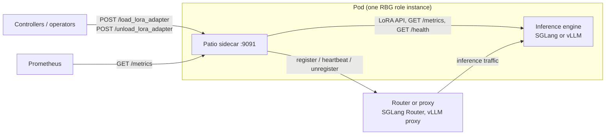
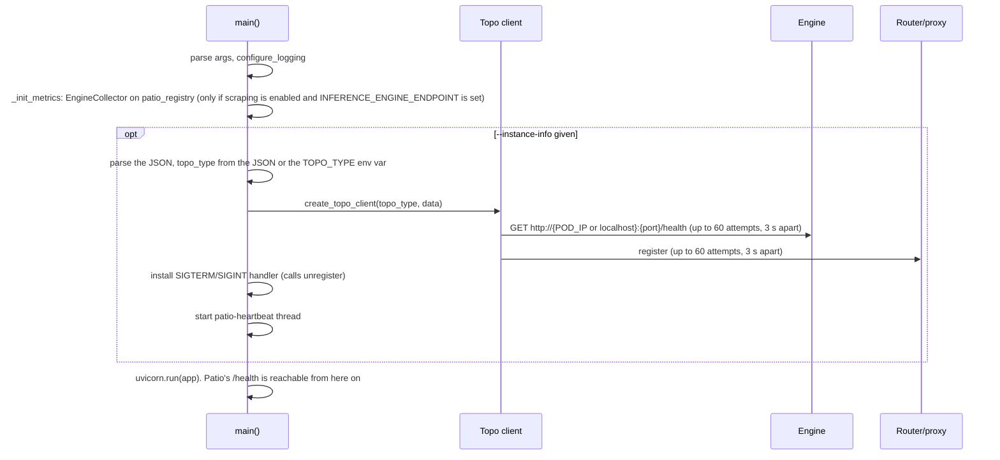
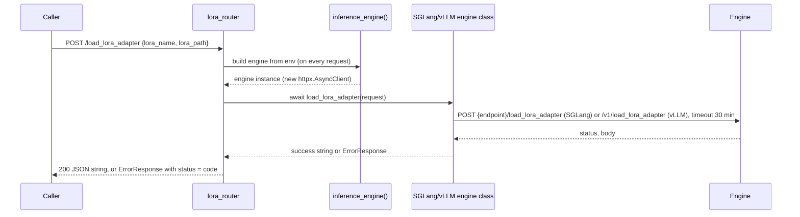
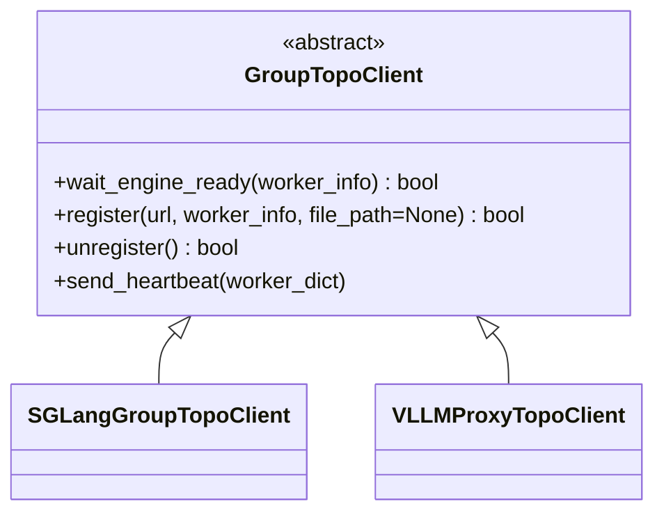

# Patio architecture reference

This file goes deeper than `AGENTS.md`. It describes behavior as implemented in `src/patio/`; where README or
`doc/` disagree, the code wins (see `.agents/skills/patio-review/references/known-issues.md`).

## 1. Context



Patio never sits on the inference data path. It proxies management calls, translates metrics, and keeps the
router's view of the worker up to date.

## 2. Process and threads

| Thread | What runs there |
|--------|-----------------|
| Main thread | `main()`: argparse, logging, `_init_metrics`, the blocking topology startup, then `uvicorn.run`, which runs the asyncio event loop |
| Event loop | `async def` handlers (`/`, `/health`, the LoRA routes) and the HTTP-metrics middleware |
| Starlette threadpool | The sync `def metrics()` handler. The engine scrape uses blocking `requests`, so it must stay a sync handler |
| `patio-heartbeat` (daemon) | `while not EXIT_EVENT.wait(timeout=HEARTBEAT_INTERVAL): topo_client.register("", worker_info)` |

`EXIT_EVENT` (`config.py`) is never set, so the heartbeat thread lives until the process exits. Logs go to
stdout and to the rotating file `/tmp/patio/patio.log` (10 MB × 10).

## 3. Startup sequence



- An invalid JSON value, a missing `topo_type` (with no `TOPO_TYPE` set), `"data": null`, or any exception
  while constructing or registering the client ends the process with `sys.exit(1)`.
- `wait_engine_ready()` and `register()` return `False` after their retries are used up. `app.py` ignores
  both results, so the server starts anyway, and the heartbeat keeps retrying registration.
- `_init_metrics` runs only when engine-metric scraping is enabled (the default) and `INFERENCE_ENGINE_ENDPOINT`
  is set. It then calls `get_metric_standard_rules(INFERENCE_ENGINE)`, which raises `ValueError` for an engine
  that has no rules, and startup fails.
- Liveness/readiness probes that target Patio must allow for the topology wait: `/health` is not served until
  registration finishes.

## 4. Shutdown sequence

On uvicorn ≥ 0.29 (verified on 0.54):

1. SIGTERM arrives. uvicorn's own handler starts a graceful shutdown and waits for in-flight requests; Patio
   sets no `timeout_graceful_shutdown`.
2. uvicorn restores the previously installed handler, Patio's `stop_topo_client_signal_handler`, and
   re-raises the signal.
3. Patio calls `topo_client.unregister()` and then `sys.exit(0)`.

On uvicorn 0.15–0.28, which `pyproject.toml` still allows (`uvicorn>=0.15.0`), uvicorn replaces Patio's handler
and never re-raises the signal, so `unregister()` never runs. In both cases the whole sequence must finish
inside the pod's termination grace period. `SGLangGroupTopoClient.unregister()` can retry 60 times, which is
far longer than the 30 s default.

## 5. HTTP layer

`app = FastAPI(title="Patio Server", debug=False)` includes `server_router` (`GET /`, `GET /health`,
`GET /metrics`) and `lora_router` (`POST /load_lora_adapter`, `POST /unload_lora_adapter`). FastAPI's
`/docs` and `/openapi.json` are always on; the `--enable-fastapi-docs` flag is ignored.

`metrics_middleware` skips paths that start with an entry in `config.EXCLUDE_ENDPOINTS` (`/metrics`). For every
other request that produces a response, it records `http_requests_total{method, endpoint, status}` and
`http_request_latency_seconds{method, endpoint}`, using the raw request path as `endpoint`. Requests that end in
an unhandled exception (bare 500s) are not recorded.

LoRA route responses:

| Situation | Status | Body |
|-----------|--------|------|
| Missing or unknown request field | 422 | FastAPI `{"detail": [...]}` |
| `INFERENCE_ENGINE_ENDPOINT` unset, or `INFERENCE_ENGINE` unsupported | 400 | `ErrorResponse`, `type="InvalidError"` |
| The engine call raised (connection error, timeout) | 500 | `ErrorResponse`, `type="ServerError"` |
| The engine returned a standard non-200 code | the same code | `ErrorResponse`, `type="ServerError"`, with the engine body in `message` |
| The engine returned a non-standard code (e.g. 520) | 500 | bare `Internal Server Error` (known issue) |
| The engine class doesn't implement the operation | 501 | `ErrorResponse`, `type="NotImplementedError"` |
| Success | 200 | JSON string, e.g. `"Success: LoRA adapter 'x' added successfully."` |

### Adding an HTTP endpoint

1. Add request/response models to `api/protocol.py`, subclassing `NoExtraBaseModel`.
2. Add the route to an existing router, or create `api/<feature>_router.py` with an `APIRouter()`, and register
   it with `app.include_router(...)` in `app.py`.
3. Return errors through the `api/response_error.py` helpers as `JSONResponse(content=err.model_dump(),
   status_code=err.code)`.
4. Use `async def` only for non-blocking work. Blocking work belongs in a sync `def` handler, which runs in the
   threadpool (like `/metrics`).
5. The middleware labels requests by raw path. Avoid path parameters, or label by route template (see the
   known issue on label cardinality).
6. Test with `TestClient(app)`, then update the README "API Reference" section and `doc/api_protocol.md`.

## 6. LoRA flow



Unload works the same way against `/unload_lora_adapter` or `/v1/unload_lora_adapter`, using httpx's default
5 s timeout. The request body is forwarded unchanged with `request.model_dump()`.

## 7. Engine abstraction

- `InferenceEngine` (`engine/base.py`) is a `@dataclass` and an `ABC` with fields `name`, `version`,
  `endpoint`, and `headers=None`. Its default `load_lora_adapter`/`unload_lora_adapter` return 501, and
  `ready()` is unused.
- Each subclass defines `__init__(name, version, endpoint, api_key=None)`, creates `self.client =
  httpx.AsyncClient(headers=...)`, and calls `super().__init__(name, version, endpoint)`. The factory never
  passes `api_key`.
- `inference_engine()` reads `INFERENCE_ENGINE`, `INFERENCE_ENGINE_VERSION`, and `INFERENCE_ENGINE_ENDPOINT`
  from `envs` on every call, compares the engine name case-insensitively, and imports the engine class
  lazily. The version is informational only; no compatibility check exists yet.

## 8. Metrics pipeline

```text
GET /metrics  (sync handler, threadpool)
  -> generate_latest(patio_registry)
       -> http_requests_total / http_request_latency_seconds   (filled by the middleware)
       -> EngineCollector.collect()
            GET urljoin(INFERENCE_ENGINE_ENDPOINT, METRIC_SCRAPE_PATH)   requests.Session, timeout 2 s
            error or non-200 -> log a warning, emit no engine metrics
            text_string_to_metric_families(text)
              for each family whose name has a rule -> rule(family) -> renamed family and samples
              every other family -> dropped
```

Current mappings (`metrics/engine_metric_rules.py`):

| Patio name | SGLang family | vLLM family |
|------------|---------------|-------------|
| `patio:num_requests_running` | `sglang:num_running_reqs` | `vllm:num_requests_running` |
| `patio:num_requests_waiting` | `sglang:num_queue_reqs` | `vllm:num_requests_waiting` |
| `patio:gpu_cache_usage_perc` | `sglang:token_usage` | `vllm:kv_cache_usage_perc` |
| `patio:time_to_first_token_seconds` | `sglang:time_to_first_token_seconds` | `vllm:time_to_first_token_seconds` |
| `patio:time_per_output_token_seconds` | none | `vllm:request_time_per_output_token_seconds` |
| `patio:inter_token_latency_seconds` | `sglang:inter_token_latency_seconds` | `vllm:inter_token_latency_seconds` |
| `patio:e2e_request_latency_seconds` | `sglang:e2e_request_latency_seconds` | `vllm:e2e_request_latency_seconds` |

`RenameStandardRule` asserts that the family name equals `old_name`, renames the family, and rewrites each
sample name as `new_name + suffix`, which keeps `_bucket`, `_sum`, `_count`, and `_total`. An exception inside a
rule propagates out of `collect()` and fails the whole `/metrics` response.

## 9. Topology



`create_topo_client(topo_type, worker_info)` in `topo/factory.py` picks the class by `topo_type.lower()`
(`"sglang"` or `"vllm"`). `worker_info` is the `data` object from `--instance-info`. `register()` takes `url`
and `file_path` only for historical reasons; `app.py` passes `""`, and the clients ignore both.

| | `SGLangGroupTopoClient` | `VLLMProxyTopoClient` |
|---|---|---|
| Router address | `{RBG_GROUP_NAME}-{ROUTER_ROLE_NAME}-0.s-{RBG_GROUP_NAME}-{ROUTER_ROLE_NAME}:{ROUTER_PORT}` | same format |
| Health check | `GET http://{POD_IP or localhost}:{port}/health`, default port 30000 | same, default port 8000 |
| Worker address | `{POD_IP}:{port}`, otherwise RBG DNS from `RBG_*` | `data.instance`, otherwise `{POD_IP}:{port}`, otherwise RBG DNS |
| Register | `POST /workers` with body = `data` minus `port` plus `url: "http://{worker}"`; needs 202 and `worker_id` | `POST /instances/add` with `{"type": data.type or data.worker_type, "instance": ...}`; any 2xx |
| Unregister | `DELETE /workers/{worker_id}`, needs 202 | no-op, returns `True` (the proxy has no API) |
| Required `data` fields | `port` (otherwise `register()` raises `KeyError`); everything else is forwarded, e.g. `worker_type`, `bootstrap_port` | `type` or `worker_type`; optional `instance` or `port` |
| Instances | singleton via `__new__`; tests reset `_instance` | a new object each time |

- **Heartbeat:** `register()` runs again every `HEARTBEAT_INTERVAL` seconds (default 10) so that a restarted
  router learns about the worker again. Registration must be idempotent. For SGLang, every heartbeat re-POSTs
  `/workers` and overwrites `worker_id`.
- **Retry:** `topo.utils.retry(func, retry_times, interval)` raises both arguments to at least 1, returns
  `func`'s result, and re-raises the last exception when every attempt fails. The clients call it with
  `retry_times=60, interval=3`, so one call can block for minutes.
- **Timeouts:** every request uses `(TOPO_CONNECT_TIMEOUT, TOPO_HEALTH_CHECK_TIMEOUT)` for health checks or
  `(TOPO_CONNECT_TIMEOUT, TOPO_REGISTER_TIMEOUT)` for register/unregister.

## 10. Legacy and unused code

| Code | Status |
|------|--------|
| `topo/server/*`, `factory.create_topo_server` | Stub topology server whose methods raise `NotImplementedError`. No route uses it |
| `GroupTopoClient.send_heartbeat` | Old worker-to-scheduler heartbeat (`/topo/register`), replaced by the heartbeat thread in `app.py` |
| `envs.get_topo_register_endpoint`, `SCHEDULER_ROLE_NAME`, `TOPO_REGISTER_ENDPOINT` | Used only by `send_heartbeat` |
| `topo/utils.get_worker_endpoint` and helpers, `write_config_file`, `TOPO_CONFIG_FILE` | Not called at runtime. The hostname format has no `s-` service prefix |
| `api/protocol.TopoRegisterRequest`, `TopoUnRegisterRequest`, `TopoInfoRequest` | No route uses them, and their `pydantic.v1` validators never run |
| `InferenceEngine.ready()`, `engine.base._is_url_ready` | Not called at runtime |
| `PROMETHEUS_MULTIPROC_DIR`, `HEALTH_CHECK_INTERVAL`, `LWS_GROUP_SIZE`, `config.DEFAULT_METRIC_COLLECTOR_TIMEOUT`, `config.DEFAULT_PATIO_HOST` | Defined but never read |

Extending any of these needs a proposal. Deleting them is a separate cleanup PR.
