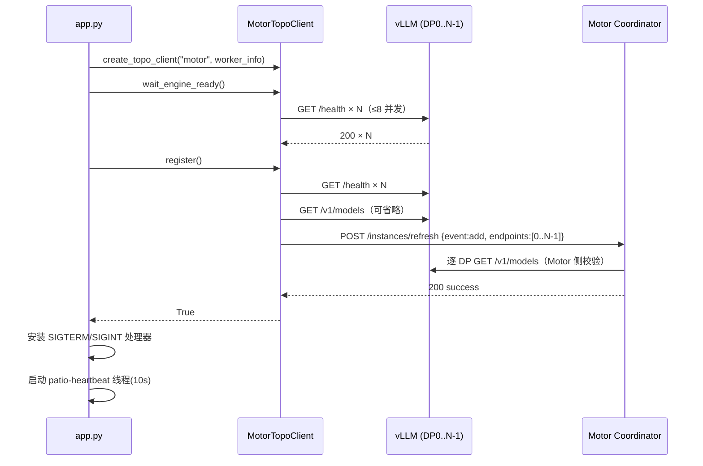
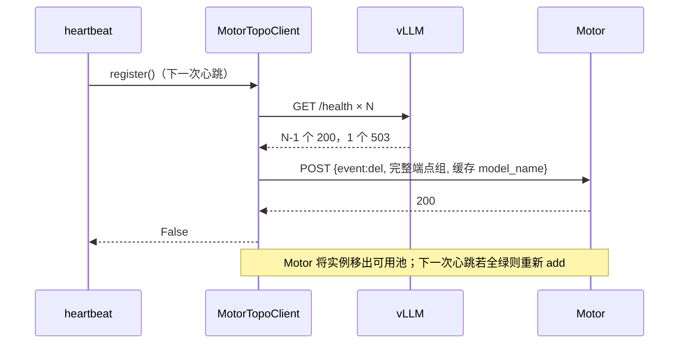
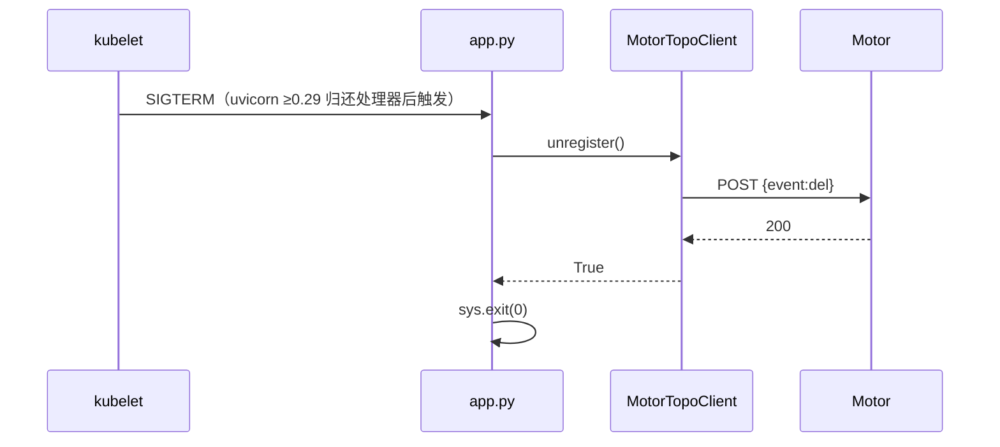
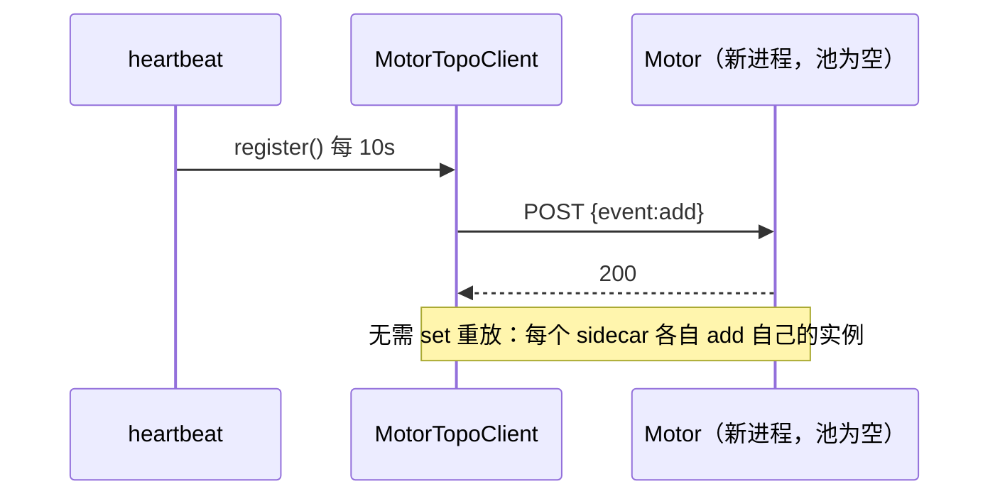

# Patio × MindIE-Motor 集成设计方案

> 适用范围：PR #6（Motor 集成）与 PR #9（多端点 DP 组）
> 代码基线：分支 `feat/motor-dp-endpoint-group`，基点 `main` @ `ce89646`
> 文档性质：**as-built 设计记录 + 决策记录**。§3 / §5 已按 D1/D2 拍板后的最终代码更新；§8 是评审意见台账（记录的是拍板前的实现与复现结果，保留以便对照）；§10 的 Q1/Q2 已拍板并落地，其余结论仍作参考。

---

## 决策横幅：D1 = A，D2 = B（已落地）

| 决策 | 结论 | 落地方式 |
| --- | --- | --- |
| **D1** 默认端点形态 | **A. 默认单端点，DP 组显式 opt-in** | internal LB（TP/PP/EP/CP、in-process DP attention、vLLM `--data-parallel-size`）只暴露一个可路由 API server，rank 0 即完整答案，Motor 得到正确的 `dp_size=1`；只有显式给出 `endpoints` / `MOTOR_INSTANCE_ENDPOINTS` / `ports` / `endpoint_num` 时才注册整组 |
| **D2** `parallel_config` + `device_num` 派生 | **B. 保留推导，但加显式开关** | 仅当 `derive_endpoints: true` 或 `MOTOR_DERIVE_ENDPOINTS` 打开时才调用 `derive_endpoint_ports()`；仅有 `parallel_config` 不再触发成组 |

随之落地的评审修复（与 §8 台账的对应关系）：

| 项 | 最终行为 |
| --- | --- |
| G-01（blocker） | `_registered` 只在 `add` 成功时置 True，确定性 4xx 不再把它清成 False → 心跳 409 后 SIGTERM/故障路径仍会发 `del`；新增回归用例 |
| G-04 | `ports: []`、`endpoints: []`、`endpoint_num < 1`、`derive_endpoints` 缺 `dp_size`/`device_num` 均在构造期报错，不再静默退化为单端点 |
| G-06 | 端口校验 `1..65535`，并在派生 id 前规范化（`h:08000` → `h:8000`） |
| G-09 | 健康门失败日志列出**全组**失败端点，而非首个 |
| — | 删除 `self.address` / `health_check_endpoint` 别名（单端点语义，已不描述整组） |

---

## 0. 阅读指南

| 章节 | 回答的问题 | 读者 |
| --- | --- | --- |
| §1 | 为什么做、做到什么程度 | 所有人 |
| §2 | 系统由哪些部分组成、边界在哪 | 架构 / 评审 |
| §3 | 一次注册从开始到结束怎么走 | 实现 / SRE |
| §4 | Patio 与 Motor/引擎/RBG 之间说什么话 | 协议 / 实现 |
| §5 | 代码改了哪些点、为什么这么改 | 实现 / 评审 |
| §6 | 怎么验证的、还缺什么验证 | 测试 / 评审 |
| §7 | 边界、风险、失败模式 | SRE / 评审 |
| §8 | 评审意见与设计缺口的对应台账 | 评审 / 决策 |
| §9 | 怎么部署、需要什么前置条件 | SRE |
| §10 | 本次需要拍板的问题 | 决策者 |

术语表：

| 术语 | 含义 |
| --- | --- |
| **实例（instance）** | Motor 路由池里的一个 P 或 D 单元，由一个 `id`、一个 `role` 和一组 endpoint 组成 |
| **端点（endpoint）** | 一个可被 Motor 直接访问的 `host:port`，通常是某个 DP rank 的 vLLM API server |
| **DP 组（endpoint group）** | 一个实例携带的全部端点，Motor 用 `dp_size = len(endpoints)` 表示 |
| **DP rank** | 端点组内的序号 `0..N-1`，作为 `endpoints[].id` 上报 |
| **External Deployer 协议** | Motor coordinator-standalone 的 `ExternalInsEventMsg` 报文形状 |
| **Controller 形状** | Motor K8s Controller 使用的 `InsEventMsg` 报文形状，本设计不发送 |

---

## 1. 背景与目标

### 1.1 问题

Patio 是跑在推理引擎 Pod 内的 sidecar。对 SGLang Router / vLLM Proxy 这类路由组件，Patio 已经有 `GroupTopoClient` 实现：启动时注册、心跳期重注册、`SIGTERM` 注销。MindIE Motor Coordinator 是同类路由/控制面组件，但此前没有 Patio 侧实现，导致使用 Motor 的部署必须靠人工或外部脚本 `python3 -m motor.coordinator.register` 维护实例池：

- 引擎起来了没人注册，流量进不来；
- 引擎死了没人摘除，Motor 没有 TTL，实例会一直留在可用池里（直到熔断器因流量失败被填充）；
- Pod 终止时无人注销，留下孤儿实例。

### 1.2 PR #9 追加的问题

PR #6 的初版按"一个 sidecar = 一个端点"上报。但生产 P/D 部署常常是"每 DP rank 一个 API server"：

- 一台 16-NPU Atlas 800I A3 上，`dp4 × tp4` 的 prefill 实例 = 4 个 prefill 端点；
- `dp16 × tp1` 的 decode 实例 = 16 个 decode 端点。

Motor 用 `dp_size = len(endpoints)` 建多端点路由表，并在 `add` 时逐 DP 校验（任一 DP 不可达则整实例拒绝）。只上报首端点会：

1. 把整个实例钉在 1 个 DP rank 上（prefill 节点的 1/4 或 decode 节点的 1/16）；
2. 让 Motor 记录错误的 `dp_size`；
3. 让健康判断只看局部，出现"部分 DP 已死但实例仍在池中"。

### 1.3 设计目标

| 目标 | 落地方式 |
| --- | --- |
| 一个 sidecar 完整表达它所属实例的全部可路由端点 | `get_worker_endpoints()` + 组内 canonical 排序 |
| 实例身份可复现、与 Motor CLI 一致 | `derive_instance_id()` 对整组端点做 CRC32 |
| 注册/注销与 Motor 的 External Deployer 协议严格对齐 | `build_body()` 只产出 `ExternalInsEventMsg` 形状，绝不混入 Controller 字段 |
| 引擎故障能自动摘除，恢复能自动重注册 | 心跳期 `register()` 内建全组健康门 |
| Pod 终止不被注销流程拖住 | `MOTOR_UNREGISTER_DEADLINE` 有界重试 + 4xx fail-fast |
| 配置错误尽早暴露 | 角色 / engine_type / dispatch plan 客户端侧校验 |
| 保持对旧单端点部署的向后兼容 | `instance` / `port` / RBG DNS 路径语义不变 |

### 1.4 非目标

- 不做 Motor 侧改造（除 #6 附带的一个 `_validate_refresh_instances` 顺序修复）；
- 不支持 `encode` / `union` 角色（External Deployer 协议没有）；
- 不支持 `engine_type != vllm`（协议限制）；
- 不实现 TTL / 租约（Motor 侧未提供）；
- 不替代 Motor 的 Controller 注册路径（`InsEventMsg`）；
- 不引入新的部署编排面（沿用 RBG headless DNS）。

---

## 2. 架构设计

### 2.1 部署架构

```
┌──────────────────────────── RBG group: <group> ────────────────────────────┐
│                                                                            │
│  ┌──────────────── Pod: <group>-prefill-0 ────────────────┐                │
│  │                                                        │                │
│  │   ┌──────────────────────┐   ┌──────────────────────┐  │                │
│  │   │ vLLM (DP0..DP3)      │   │ Patio sidecar        │  │                │
│  │   │ :7100 :7102          │◄──┤ :9091                │  │                │
│  │   │ :7104 :7106          │   │  - /health gate      │  │                │
│  │   └──────────────────────┘   │  - /v1/models probe  │  │                │
│  │                              │  - MotorTopoClient   │  │                │
│  │                              └──────────┬───────────┘  │                │
│  └─────────────────────────────────────────┼──────────────┘                │
│                                            │ POST /instances/refresh       │
│  ┌──────────────── Pod: <group>-decode-0 ──┼──────────────┐                │
│  │   vLLM (DP0..DP15) + Patio sidecar ─────┤              │                │
│  └─────────────────────────────────────────┼──────────────┘                │
│                                            ▼                               │
│                        ┌───────────────────────────────────┐               │
│                        │ Motor Coordinator (standalone)    │               │
│                        │  :1025 推理   :1026 管理          │               │
│                        │  :1027 可观测                     │               │
│                        │  - P/D 路由池                     │               │
│                        │  - 无 TTL / 无主动健康轮询        │               │
│                        └───────────────┬───────────────────┘               │
│                                        │ 路由 P/D 流量                    │
└────────────────────────────────────────┼───────────────────────────────────┘
                                         ▼
                                   推理请求入口
```

关键事实：

- 一个 Pod = 一个 P/D 实例 = 一个**端点组**（组可以跨 Pod，见 §2.5.2）；
- Motor 只提供"注册/注销"管理面，**没有主动健康检查循环**，健康判定必须由 Patio 承担；
- Motor 管理端口与推理端口分离（1026 vs 1025），`ROUTER_PORT` 必须指向 1026。

### 2.2 模块与分层

```
src/patio/
├── app.py                          # 进程入口：解析 --instance-info、生命周期、信号、心跳线程
├── config.py                       # 常量：DEFAULT_PATIO_PORT / SUPPORTED_TOPO_TYPES(+Motor)
├── envs.py                         # 环境变量注册表（Motor 相关 + 注销预算）
├── topo/
│   ├── factory.py                  # create_topo_client(topo_type) → 具体 GroupTopoClient
│   ├── utils.py                    # retry / write_config_file / get_worker_endpoint
│   └── client/
│       ├── base_topo_client.py     # GroupTopoClient 抽象（3 个抽象方法 + send_heartbeat）
│       ├── sgl_topo_client.py      # SGLang Router
│       ├── vllm_topo_client.py     # vLLM Proxy
│       └── motor_topo_client.py    # Motor Coordinator（本设计主体，806 行）
```

分层原则：**MotorTopoClient 不引入新的抽象层**，它就是 `GroupTopoClient` 的第三个实现，与 SGLang/vLLM 平级；生命周期、重试、心跳全部复用既有框架。

### 2.3 抽象契约 `GroupTopoClient`

```python
class GroupTopoClient(ABC):
    @abstractmethod
    def wait_engine_ready(self, worker_info: dict) -> bool: ...
    @abstractmethod
    def register(self, url: str, worker_info: dict, file_path=None) -> bool: ...
    @abstractmethod
    def unregister(self): ...

    def send_heartbeat(self, worker_dict: dict):  # 基类提供，Motor 不使用
        while not EXIT_EVENT.is_set():
            time.sleep(HEARTBEAT_INTERVAL)
            self.register(...)
```

设计约定：

| 方法 | 语义 | Motor 实现差异 |
| --- | --- | --- |
| `wait_engine_ready` | 启动期阻塞等待引擎就绪 | 探测**组内每个**端点的 `/health`，全部 200 才返回 True |
| `register` | 注册；心跳期会被反复调用 | **本身即故障检测器**：健康门失败先 `del` 再返回 False |
| `unregister` | 注销 | 有界重试（10s 预算）+ 4xx fail-fast |
| `send_heartbeat` | 基类心跳循环 | **未使用**：Motor 由 `app.py` 的 `patio-heartbeat` 线程驱动 |

`register(url, worker_info, file_path)` 的 `url` / `file_path` 对 Motor 无意义（Motor 端点由环境变量派生），保留签名只为满足接口。

### 2.4 三类 TopoClient 对比

| 维度 | SGLang | vLLM Proxy | Motor |
| --- | --- | --- | --- |
| 注册端点 | Router `/workers` | Proxy `/instances/add` | Coordinator `/instances/refresh` |
| 报文 | 自定义 worker 信息 | `{type, instance}` | `ExternalInsEventMsg` |
| 实例粒度 | worker | instance | instance + 端点组 |
| 身份 | 服务端分配/自描述 | instance 字符串 | CRC32 派生整数 id |
| 角色 | 任意 | `type` 透传 | 仅 `prefill` / `decode` |
| 健康责任 | Router 侧 | Proxy 侧 | **Patio 侧（Motor 无探活）** |
| 注销语义 | 删除 worker | `/remove_worker` | `event=del`，幂等 |
| 多端点 | — | — | **一等公民**（`dp_size`） |

### 2.5 数据模型

#### 2.5.1 输入：`worker_info`

来源是 `--instance-info` JSON 的 `data` 字段（`topo_type` 为同级字段）。Motor 客户端识别的字段：

| 字段 | 类型 | 必填 | 语义 |
| --- | --- | --- | --- |
| `type` / `worker_type` | str | ✅ | `prefill` / `decode`（大小写、空白归一化） |
| `instance` | str | ❌ | 显式地址 `host:port`（优先级最高） |
| `port` | int/str | ❌ | 本 Pod 引擎端口，默认 8000 |
| `endpoints` | list[str \| dict] | ❌ | 权威端点组（可跨 Pod） |
| `ports` | list[int] | ❌ | 本 Pod 的 DP 端口列表 |
| `endpoint_num` | int | ❌ | 需要派生的端点数 |
| `parallel_config` | dict | ❌ | `dp_size` / `tp_size` / `pp_size` / `pcp_size` / `local_world_size` |
| `data_parallel_size` | int | ❌ | `parallel_config.dp_size` 的别名 |
| `device_num` / `npu_num` | int | ❌ | 节点 NPU 数（派生端口用） |
| `base_port` | int | ❌ | 派生端口起点，默认 10000 |
| `port_step` | int | ❌ | 派生端口步长，默认 2 |

#### 2.5.2 内部模型：端点组与实例身份

**端点组**是一个 canonical 列表：

```python
addresses = sort_endpoints([...])
# 规范化：normalize_endpoint() → split_address() → format_address()
# 排序键： (host, int(port))       ← 与 Motor CLI 一致
# 约束：  同一 (host, port) 不得出现两次
```

排序是**字符串序的 host + 整数序的 port**，因此 `10.0.0.10` 排在 `10.0.0.2` 之前（与 Motor CLI 行为一致，已在测试中固化）。

**实例身份**：

```
identity   = "|".join([role, *sorted_addresses])
digest     = crc32(identity.encode()) & 0x3FFFFFFF
instance_id = 0x40000000 | digest
```

- 命名空间位 `0x40000000` 把 sidecar/CLI 的 id 与 Controller 下发的 id 隔开；
- 整组参与摘要 → 端点组相同则 id 相同，与输入顺序无关；
- 单端点实例退化为 `role|host:port` 的旧语义（地址先规范化，见 §5.6）。

#### 2.5.3 输出：`ExternalInsEventMsg`

```jsonc
{
  "event": "add" | "del",                       // sidecar 只用这两个
  "model_name": "DeepSeek-V4-Flash",            // 可选
  "dispatch_capabilities": "prefill_handoff_decode",  // 单个枚举值
  "engine_type": "vllm",
  "instances": [
    {
      "id": 1147345019,
      "role": "prefill",
      "endpoints": [
        {"id": 0, "address": "10.0.0.1:7100"},
        {"id": 1, "address": "10.0.0.1:7102"}
      ]
    }
  ]
}
```

设计约束：

- schema 为 `extra="forbid"`，Patio 只产出上述字段；
- **绝不混入** Controller 形状字段（`job_name`、`status`、`enable_multi_endpoints`、dict 形态的 `endpoints`），否则 Motor 的形状判别器会把请求路由到另一个 schema；
- `endpoints[].id` = DP rank（`0..N-1`），`endpoints[].address` = 合并的 `host:port`（IPv6 用 `[addr]:port`）；
- `job_name` / `status` / `dp_size` / 多端点路由表全部由 Motor 在 `to_internal()` 派生。

### 2.6 配置面

三层配置，优先级从高到低：`worker_info` 字段 → 环境变量 → 代码默认值。

| 环境变量 | 默认 | 归属 | 作用 |
| --- | --- | --- | --- |
| `TOPO_TYPE` | – | `envs.py` | 选 `Motor`（factory 大小写不敏感） |
| `ROUTER_ROLE_NAME` | – | `envs.py` | Motor Coordinator 的 RBG role |
| `ROUTER_PORT` | – | `envs.py` | Motor **管理**端口（通常 1026） |
| `MOTOR_MODEL_NAME` | 探测 `/v1/models` | `envs.py` | 注册用模型名 |
| `MOTOR_MGMT_API_KEY_FILE` | – | `envs.py` | 管理 API key 文件路径 |
| `MOTOR_ENGINE_TYPE` | `vllm` | `envs.py` | 仅接受 `vllm` |
| `MOTOR_DISPATCH_CAPABILITIES` | `prefill_handoff_decode` | `envs.py` | 单个 dispatch plan |
| `MOTOR_UNREGISTER_DEADLINE` | `10` | `envs.py` | 注销总预算（秒） |
| `MOTOR_UNREGISTER_INTERVAL` | `1` | `envs.py` | 注销重试间隔 |
| `MOTOR_UNREGISTER_TIMEOUT` | `3` | `envs.py` | 注销单请求超时 |
| `MOTOR_INSTANCE_ENDPOINTS` | – | `envs.py` | 逗号分隔端点组（显式 opt-in） |
| `MOTOR_BASE_PORT` / `MOTOR_PORT_STEP` / `MOTOR_ENDPOINT_NUM` | 10000 / 2 / – | `envs.py` | 端口生成 |
| `MOTOR_DERIVE_ENDPOINTS` | 关闭 | `envs.py` | 显式打开 `parallel_config` 派生 |
| `TOPO_CONNECT_TIMEOUT` / `TOPO_HEALTH_CHECK_TIMEOUT` / `TOPO_REGISTER_TIMEOUT` | 3 / 30 / 10 | `envs.py` | 复用既有超时 |
| `HEARTBEAT_INTERVAL` | `10` | `envs.py` | 心跳周期 |

> 注：G-07 指出的行内 `os.getenv` 已全部收进 `envs.py`，与项目其余配置保持一致。

### 2.7 职责边界

| 关注点 | 归属 | 位置 |
| --- | --- | --- |
| 管理端点发现 | Patio | `get_motor_endpoint()`（RBG headless DNS 拼接） |
| 报文 schema 与校验 | **Motor** | `ExternalInsEventMsg.to_internal()` |
| 实例身份派生 | Patio | `derive_instance_id()`（与 Motor CLI 同算法） |
| 端点组解析/规范化 | Patio | `get_worker_endpoints()` / `sort_endpoints()` |
| 健康判定 | **Patio** | 全组 `/health` 门 |
| 路由表与 P/D 调度 | **Motor** | 内部实例模型 |
| 注销预算 | Patio | `MOTOR_UNREGISTER_DEADLINE` |
| 过期/回收 | **Motor（当前未提供）** | 无 TTL |

---

## 3. 流程设计

### 3.1 生命周期状态机

```
                    ┌──────────────┐
       进程启动 ───► │ UNREGISTERED │ ◄──────────── SIGTERM 前 ─┐
                    └──────┬───────┘                            │
                           │ health 全绿 + add 2xx              │
                           ▼                                    │
                    ┌──────────────┐   health 任一失败           │
                    │  REGISTERED  │ ──────────────► DEREGISTERING
                    └──────┬───────┘                       │    │
                           │ add 2xx（心跳幂等）           │    │
                           └──────────► REGISTERED        │    │
                                                          ▼    │
                                                   UNREGISTERED┘
```

镜像变量 `_registered: bool` 是唯一状态载体：

- `register()` 成功 → True；`unregister()` 成功 / 404 → False；
- 心跳线程与信号处理器共享该变量，**无锁**（并发缺口见 G-03）。

### 3.2 端点组解析流程

`get_worker_endpoints(worker_info)` 五级优先级，**首个命中即返回**：

```
worker_info["endpoints"] ──有──► normalize + sort + 重复校验 ──► 返回整组
        │无
        ▼
MOTOR_INSTANCE_ENDPOINTS ──非空──► split(",") + sort ──► 返回整组
        │无
        ▼
worker_info["ports"] ──有──► host(本 Pod) + 各 port ──► sort ──► 返回整组
        │无
        ▼
endpoint_num / MOTOR_ENDPOINT_NUM ──有──► base_port + i*port_step ──► 返回整组
        │无
        ▼
derive_endpoints / MOTOR_DERIVE_ENDPOINTS 打开？
        ├──是──► parallel_config + device_num ──► derive_endpoint_ports() ──► 返回整组
        │
        └──否──► 单值兜底：get_worker_address() ──► 单端点组（D1 默认）
                 （instance → POD_IP:port → RBG DNS）
```

派生端口的镜像算法（与 Motor `node_manager.py::_generate_endpoint_ports` 一致）：

```python
endpoint_num = min(dp_size, device_num // local_world_size)
ports        = [base_port + i * port_step for i in range(endpoint_num)]
# local_world_size 缺省 = tp_size * pp_size * pcp_size
```

设计意图（D1 = A，D2 = B）：

- 显式列表优先，保证"部署说了算"；
- **默认单端点**：internal LB 拓扑下 rank 0 就是完整答案，自动成组会注册不存在的端口；
- 派生只在"部署明确打开开关、并给了 DP 规模"时启用，避免无依据猜端口；
- 单值兜底保证旧部署零改动可用；
- 显式给出但无效的配置（`ports: []`、`endpoints: []`、`endpoint_num < 1`、缺 `dp_size`/`device_num`）直接报错，不退化为单端点（G-04）。

### 3.3 实例身份派生流程

```
role ─┐
      ├─► sort_endpoints(...) ─► "role|a|b|c" ─► crc32 & 0x3FFFFFFF ─► | 0x40000000 ─► id
端点组 ┘
```

设计不变量：

1. **顺序无关**：同一物理组任意输入顺序 → 同一 id；
2. **CLI 等价**：同一组端点，Patio 与 `python3 -m motor.coordinator.register` 得到同一 id（IPv4 / DNS / bracketed IPv6 已验证）；
3. **跨重启稳定**：只要端点组不变，Pod 重启后 id 不变，`add` 命中幂等；
4. **反向**：id 变了意味着端点组变了，旧 id 会留在 Motor 池中（无 TTL）。

### 3.4 就绪门 `wait_engine_ready`

```
retry(最多 60 次, 间隔 3s):
    for each endpoint in 组内端点 (≤8 并发):
        GET http://<endpoint>/health   (connect 3s, read 30s)
    all 200 ? 返回 True : 抛错触发重试
```

- 失败时打印**全部**端点 URL，便于定位是哪个 DP 没起来；
- 返回值被 `app.py` 忽略：真正的准入判定在 `register()` 的健康门里（`wait_engine_ready` 只是启动期等待，避免立刻进入注册风暴）。

### 3.5 注册 `register()`

```
register(url, worker_info)
  │
  ├─ 1. 全组健康门 _engine_healthy()
  │      ├─ 失败 → 若 _registered: unregister()（发 del）→ 返回 False
  │      └─ 成功 ↓
  ├─ 2. _resolve_model_name()   # env 优先，否则 GET /v1/models，成功即缓存
  ├─ 3. build_body(event="add", role, endpoints=整组, instance_id, model_name)
  ├─ 4. _do_register():
  │        POST http://<mgmt>/instances/refresh   (connect 3s, read 10s)
  │        2xx        → True
  │        4xx        → 记 error、返回 False（不重试）
  │        其它/异常  → 抛错
  └─ 5. 按 utils.retry(60 次, 3s) 包裹第 4 步；异常 → 返回 False
```

设计意图：

- **健康门在前**：Motor 对 `add` 做整组校验，部分 DP 不可达会被整实例拒绝；先本地拦截，避免每个心跳都向 Motor 发一次注定 400 的请求；
- **4xx 不重试**：注册跑在 10s 心跳里，一次 4xx 重试 60 次会把心跳线程占满；且 4xx 是确定性拒绝（身份冲突/报文非法）；
- **5xx/传输错误重试**：Coordinator 未就绪是正常启动时序；
- **model_name 在注册期解析并缓存**：注销时引擎通常已死，依赖 Motor 回源探测会 400。

> 实现现状：第 5 步写作 `self._registered = bool(utils.retry(...))`，4xx 会把镜像从 True 清成 False，导致后续 `unregister()` 短路不发 `del`（见 G-01，已复现）。

### 3.6 心跳与故障检测

```
app.py: patio-heartbeat (daemon)
  每 HEARTBEAT_INTERVAL(10s):
      topo_client.register("", worker_info)
```

`register()` 兼作故障检测器，形成"心跳即探活"：

| 引擎状态 | 本次心跳动作 | Motor 池变化 |
| --- | --- | --- |
| 全组健康 | `add`（幂等 no-op） | 无变化 |
| 任一 DP 不健康，已注册 | 先 `del` 再返回 False | 实例移出可用池 |
| 任一 DP 不健康，未注册 | 直接返回 False | 无变化 |
| 引擎恢复 | 下一次心跳 `add` | 实例回到池中 |

设计取舍：**不额外维护"健康→注册状态"的边沿检测**，用"每次心跳都门控 + add 幂等"换取实现简单；代价是每次心跳都做一次全组 HTTP 探测。

### 3.7 注销 `unregister()`

```
unregister()
  ├─ _registered == False → 直接返回 True（无 del）
  ├─ build_body(event="del", 整组, instance_id, 缓存 model_name)
  └─ deadline = now + MOTOR_UNREGISTER_DEADLINE(10s)
       loop:
         POST /instances/refresh (connect 3s, read 3s)
           2xx  → _registered=False; True
           404  → 视为已注销; _registered=False; True
           4xx  → 记 error; False（立即放弃）
           其它 → 抛错，进入重试
         except → 记录最后错误
         remaining <= 0 → 记 error; False
         sleep(min(INTERVAL, remaining))
```

设计意图：

- 运行在 SIGTERM/SIGINT 处理器里，**必须有界**（旧实现复用 60×3s≈180s 预算，会拖住 Pod 终止）；
- `del` 必须携带**与 `add` 完全相同的整组端点**：Motor 按"role + 物理端点集合"识别删除，部分组会 409；
- `del` 携带注册期缓存的 `model_name`：引擎已死时 Motor 不再回源探测；
- 404 视为"目标状态已达成"（防御性分支，Motor 实际对未知 id 返回 200）；
- 只有成功/404 才清 `_registered`，保证失败后心跳仍可重试注销。

### 3.8 错误分类与重试策略汇总

| 场景 | 分类 | 注册路径 | 注销路径 |
| --- | --- | --- | --- |
| 2xx | 成功 | 完成 | 完成 |
| 400 报文/角色/模型不一致 | 确定性 | fail-fast | fail-fast |
| 400 "no fully reachable instances" | 半确定性 | fail-fast，下次心跳重试 | fail-fast |
| 401/403 API key | 确定性 | fail-fast | fail-fast |
| 404 实例不存在 | 幂等 | —（add 不会 404） | 视为成功 |
| 409 id 冲突/身份不匹配 | 确定性 | fail-fast | fail-fast |
| 5xx / 超时 / 连接失败 | 瞬时 | 60×3s 重试 | 截止预算内 1s 间隔重试 |

---

## 4. 交互设计

### 4.1 HTTP 契约

| 项 | 值 |
| --- | --- |
| 方法 / 路径 | `POST http://<mgmt_endpoint>/instances/refresh` |
| 管理端点 | `<group>-<router>-0.s-<group>-<router>:<ROUTER_PORT>` |
| 认证 | `X-Motor-Management-Key: <file content>`（可选） |
| Content-Type | `application/json` |
| 事件 | `add`（注册/心跳）、`del`（注销） |
| 成功响应 | `{"request_id":"refresh_request","status":"success","message":...,"data":{"event_type":...}}` |
| 幂等性 | 重复 `add` 200 no-op；未知 id 的 `del` 200 |

### 4.2 报文样例

**单端点 add（向后兼容路径）**

```json
{
  "event": "add",
  "model_name": "Qwen2.5-7B",
  "dispatch_capabilities": "prefill_handoff_decode",
  "engine_type": "vllm",
  "instances": [
    {"id": 1166527670, "role": "prefill",
     "endpoints": [{"id": 0, "address": "10.10.0.11:8000"}]}
  ]
}
```

**dp4×tp4 多端点 add**

```json
{
  "event": "add",
  "model_name": "DeepSeek-V4-Flash",
  "dispatch_capabilities": "prefill_handoff_decode",
  "engine_type": "vllm",
  "instances": [
    {"id": 1147345019, "role": "prefill",
     "endpoints": [
       {"id": 0, "address": "10.0.0.1:7100"},
       {"id": 1, "address": "10.0.0.1:7102"},
       {"id": 2, "address": "10.0.0.1:7104"},
       {"id": 3, "address": "10.0.0.1:7106"}
     ]}
  ]
}
```

**del（携带注册期缓存的 model_name）**

```json
{
  "event": "del",
  "model_name": "DeepSeek-V4-Flash",
  "dispatch_capabilities": "prefill_handoff_decode",
  "engine_type": "vllm",
  "instances": [
    {"id": 1147345019, "role": "prefill",
     "endpoints": [{"id": 0, "address": "10.0.0.1:7100"}, "..."]}
  ]
}
```

### 4.3 Motor 侧行为依赖

以下行为来自 Motor 源码复核（`master@09b27a9`），是设计成立的前提：

| 依赖 | 说明 | 对 Patio 的约束 |
| --- | --- | --- |
| 形状判别 | 依据是否存在 Controller 字段（`job_name` / dict endpoints / `status`）分流 | 报文绝不能混形状 |
| 字段派生 | `job_name=external-<role>-<id>`、`status=active`、`dp_size=len(endpoints)` | Patio 不发送这些字段 |
| `add` 逐 DP 探测 | 即使带 `model_name` 也会探测每个可达 DP 的 `/v1/models`（每端点 2s） | 健康门必须覆盖整组 |
| `del` 探测语义 | 带 `model_name` → 跳过探测；不带 → 探测已死引擎会 400 | del 必须带缓存名 |
| 删除身份 | 按 role + 端点集合匹配，部分组 409 | del 必须带完整组 |
| 无 TTL | 没有过期/回收 | `del` 是唯一撤除手段 |
| `del` 可能越过 `add` | `add` 的解析在 `_refresh_lock` 之前完成 | add/del 需串行化（G-03） |
| 未知 id 删除 | 返回 200 而非 404 | 404 分支为防御性代码 |
| 管理端口 | 1026（推理 1025 / 可观测 1027） | `ROUTER_PORT=1026` |
| 绑定地址 | 默认 `127.0.0.1`，除非注入 `POD_IP` 或设 `coordinator_api_host` | K8s 必须注入 `POD_IP` |
| API key | 默认关闭；TLS 仅服务端认证且证书缺失时**fail open** | 跨主机暴露必须开 key + TLS |

### 4.4 与引擎的交互

| 交互 | 时机 | 端点 | 超时 |
| --- | --- | --- | --- |
| 健康探测 | 启动期（60×3s）+ 每次心跳 | `GET http://<每个端点>/health` | connect 3s / read 30s |
| 模型名解析 | 注册前（未配置 `MOTOR_MODEL_NAME` 时） | `GET http://<首端点>/v1/models` | 同上 |
| LoRA / 指标 | 与本设计无关 | — | — |

模型名解析规则：只接受**恰好 1 个** model id；0 个或多个 → 记 warning，`model_name` 留空交 Motor 探测。

### 4.5 与 RBG / 环境的交互

```
RBG 注入：RBG_GROUP_NAME / RBG_ROLE_NAME / RBG_ROLE_INDEX / POD_IP / ROUTER_*
    │
    ├─ Motor 管理端点 = {group}-{router}-0.s-{group}-{router}:{ROUTER_PORT}
    └─ 本 Pod 地址   = POD_IP:port  或  {group}-{role}-{index}.s-{group}-{role}:port
```

### 4.6 关键时序

**A. 正常启动**



**B. 引擎部分 DP 死亡**



**C. SIGTERM 注销**



**D. Coordinator 重启**



### 4.7 并发与线程模型

| 线程 | 职责 | 阻塞上限 |
| --- | --- | --- |
| main | uvicorn 服务 + 信号处理器 | `unregister()` ≤ 10s + 一次请求超时 |
| `patio-heartbeat`（daemon） | 每 10s `register()` | 健康门 ≤ ⌈N/8⌉×30s + 注册重试 60×3s |

共享状态：`_registered`（bool）、`_model_name`（str|None）。**当前无锁**，`register()` 与 `unregister()` 可并发（G-03）。

---

## 5. 关键代码修改点

### 5.1 文件清单与提交归属

| 文件 | 变更 | 提交 |
| --- | --- | --- |
| `src/patio/topo/client/motor_topo_client.py` | 新增 806 行（客户端全实现） | `a914f5b` → `c01d27d` 演进 |
| `src/patio/topo/factory.py` | `+elif topo_type.lower() == "motor"` | `a914f5b` |
| `src/patio/config.py` | `Motor = "Motor"`，加入 `SUPPORTED_TOPO_TYPES` | `a914f5b` |
| `src/patio/envs.py` | `MOTOR_*` 环境变量 + 注销预算 | `a914f5b` / `44591c6` |
| `tests/mock_tests/test_motor_topo_client.py` | 新增 74 个用例 | 三次提交累计 |
| `tests/mock_tests/test_topo_factory.py` | `+1` motor factory 用例 | `a914f5b` |
| `doc/motor_registration.md` | 新增 304 行设计记录 | `a914f5b`~`c01d27d` |
| `README.md` / `doc/README.md` | Motor 配置段 + 索引 | 同上 |

### 5.2 常量（`motor_topo_client.py:68-101`）

| 常量 | 值 | 作用 |
| --- | --- | --- |
| `STANDALONE_ID_NAMESPACE` | `0x40000000` | id 命名空间位 |
| `STANDALONE_ID_MASK` | `0x3FFFFFFF` | 摘要掩码 |
| `MOTOR_EXTERNAL_ROLES` | `("prefill","decode")` | 协议允许的角色 |
| `MOTOR_EXTERNAL_DISPATCH_PLANS` | `("prefill_handoff_decode","concurrent_engine_sync")` | 协议允许的派发计划 |
| `MOTOR_DISPATCH_CAPABILITY` | `prefill_handoff_decode` | 默认计划 |
| `MOTOR_EXTERNAL_ENGINE_TYPE` | `vllm` | 协议唯一支持的引擎族 |
| `MOTOR_MGMT_API_KEY_HEADER` | `X-Motor-Management-Key` | 管理面鉴权头 |
| `DEFAULT_ENGINE_PORT` | `8000` | 裸主机默认端口 |
| `DEFAULT_BASE_PORT` / `DEFAULT_PORT_STEP` | `10000` / `2` | 派生端口约定 |

### 5.3 辅助函数（模块级，可独立测试）

| 函数 | 签名 | 设计要点 |
| --- | --- | --- |
| `get_motor_endpoint` | `() -> str` | RBG DNS 拼接；缺变量→`RuntimeError` |
| `get_mgmt_headers` | `() -> dict` | 读 key 文件；`OSError` 只告警不失败 |
| `detect_worker_type` | `(worker_info) -> str` | `type`/`worker_type` 归一化；限制在两角色 |
| `get_dispatch_capability` | `() -> str` | 恰好一个值；空→默认 |
| `get_engine_type` | `() -> str` | 只接受 `vllm` |
| `get_worker_address` | `(worker_info) -> str` | instance → POD_IP → RBG DNS |
| `split_address` | `(str) -> (host, port)` | 裸主机→8000；bracketed IPv6；裸 IPv6 视为 host |
| `format_address` | `(host, port) -> str` | IPv6 加括号 |
| `normalize_endpoint` | `(item) -> str` | str 或 dict（address/instance/ip/host+port/business_port） |
| `sort_endpoints` | `(iterable) -> list[str]` | canonical 排序 + 重复拒绝 |
| `derive_endpoint_ports` | `(dp, lws, dev, base=10000, step=2) -> list[str]` | Motor `_generate_endpoint_ports` 镜像 |
| `get_worker_endpoints` | `(worker_info) -> list[str]` | 五级优先级解析 |
| `derive_instance_id` | `(role, endpoints) -> int` | 整组 CRC32 |
| `build_body` | `(event, role, endpoints, id, model_name=None) -> dict` | 只产 External 形状 |

### 5.4 类结构

| 成员 | 作用 |
| --- | --- |
| `__init__` | 解析管理端点、header、role、端点组、id；初始化 `_registered=False`、`_model_name` |
| `_resolve_model_name` | env > `/v1/models`；成功即缓存 |
| `_probe_endpoint_health`（static） | 单端点 `/health` 探测，返回 `(address, ok, reason)` |
| `_engine_healthy` | 并发探测全组，全 200 才 True；失败日志列出全部失败端点 |
| `wait_engine_ready` | 60×3s 等待全组就绪 |
| `register` | 健康门 → 解析模型名 → `add`（4xx fail-fast / 5xx 重试） |
| `unregister` | `del`，截止预算内重试，4xx/404 语义特殊处理 |

### 5.5 关键实现片段

**(1) 整组身份（`derive_instance_id`）**

```python
addresses = sort_endpoints([endpoints] if isinstance(endpoints, str) else list(endpoints))
identity = "|".join([role, *addresses])
digest = zlib.crc32(identity.encode()) & STANDALONE_ID_MASK
return STANDALONE_ID_NAMESPACE | digest
```

改动意义：从"单地址"变为"整组"，是 PR #9 的核心；单端点输入仍可用（`str` 分支）。

**(2) 报文构造（`build_body`）**

```python
addresses = sort_endpoints([endpoints] if isinstance(endpoints, str) else list(endpoints))
body = {
    "event": event,
    "dispatch_capabilities": get_dispatch_capability(),
    "engine_type": get_engine_type(),
    "instances": [{
        "id": instance_id,
        "role": role,
        "endpoints": [{"id": i, "address": a} for i, a in enumerate(addresses)],
    }],
}
if model_name:
    body["model_name"] = model_name
```

改动意义：`address` 单值 → `endpoints[]` 列表 + DP rank；再次 canonical 化保证 body 与 id 同源。

**(3) 端点组解析（`get_worker_endpoints`）**

见 §3.2。实现细节：`endpoints` 为空列表时不回落环境变量而直接报错；`ports`/`endpoint_num` 使用真值判断（G-04）。

**(4) 全组健康门（`_engine_healthy`）**

```python
targets = self.health_check_endpoints
if len(targets) == 1:
    results = [self._probe_endpoint_health(targets[0])]
else:
    with ThreadPoolExecutor(max_workers=min(8, len(targets))) as ex:
        results = list(ex.map(self._probe_endpoint_health, targets))
return not [r for r in results if not r[1]]
```

改动意义：从"只看首端点"变为"全组 AND"，与 Motor 的整实例校验语义对齐。

**(5) 注册状态镜像（`register` 尾部）**

```python
self._registered = bool(utils.retry(_do_register, retry_times=60, interval=3))
return self._registered
```

`_do_register` 对 4xx 返回 False（fail-fast），因此该赋值会把已注册实例的镜像清成 False（G-01）。

**(6) 有界注销（`unregister`）**

```python
deadline = time.monotonic() + envs.MOTOR_UNREGISTER_DEADLINE
while True:
    try:
        resp = requests.post(..., timeout=(connect, MOTOR_UNREGISTER_TIMEOUT))
        if 2xx: ...
        if 404: ...
        if 4xx: return False
        raise RuntimeError(...)
    except Exception as e:
        last_error = e
    remaining = deadline - time.monotonic()
    if remaining <= 0: return False
    time.sleep(min(INTERVAL, remaining))
```

设计意图：SIGTERM 路径确定性收敛；单次请求超时不参与剩余预算裁剪（G-05）。

### 5.6 向后兼容矩阵

| 输入形态 | 旧行为（#6 初版） | 新行为（#9） | id 是否变化 |
| --- | --- | --- | --- |
| `instance="10.0.0.1:8000"` | 单端点 | 单端点 | 不变 |
| `port=8000` + `POD_IP`(IPv4) | 单端点 | 单端点 | 不变 |
| RBG DNS 兜底 | 单端点 | 单端点 | 不变 |
| `instance="myhost"`（无端口） | 单端点，id 基于原始串 `role\|myhost` | 规范化为 `myhost:8000`，id 基于 `role\|myhost:8000` | **变**（与 CLI 对齐） |
| `instance="[2001:db8::1]:8200"` | 单端点 | 单端点 | 不变 |
| `POD_IP` 为 IPv6 | 地址拼接错误 | 仍错误（G-02） | 变（但不可用） |
| `endpoints=[...]` | 不支持 | N 端点组 | 新能力 |
| `ports` / `endpoint_num` | 不支持 | 派生 N 端点 | 新能力 |
| `parallel_config` + `device_num`（未开 `derive_endpoints`） | 不支持 | **单端点**（D2：不再隐式成组） | 不变 |
| `parallel_config` + `device_num` + `derive_endpoints` | 不支持 | 派生 N 端点 | 新能力 |

### 5.7 测试变更

| 层面 | 用例数 | 覆盖点 |
| --- | --- | --- |
| 辅助函数 | ~30 | id、地址解析、端点规范化、端口派生、优先级 |
| 报文形状 | ~10 | add/del、不混形状、IPv6、重复拒绝、顺序无关、dict 条目 |
| 初始化 | ~7 | 角色、RBG 缺失、显式 instance、多端点 |
| 就绪/健康 | ~5 | 全组探测、单端点 503、部分不可达 |
| 注册 | ~8 | POST 形状、模型名解析/省略、4xx 不重试、故障撤销 |
| 注销 | ~9 | del 形状、整组、缓存名、404、4xx、5xx 重试、截止预算、恢复 |
| 配置/factory | ~5 | engine_type、dispatch plan、factory 选择 |

---

## 6. 测试设计

### 6.1 分层策略

| 层 | 目标 | 现状 |
| --- | --- | --- |
| 单元（pytest + mock） | 纯函数与类行为 | 136 passed（motor 74） |
| 契约（Motor 形状/派生） | 报文能被真实 Motor 接受 | 已在沙箱用真实 `ExternalInsEventMsg` 验证（非仓库内自动化） |
| 端到端（真实 HTTP） | 注册→幂等→注销→恢复 | 手工验证过，未进入 CI |
| e2e 脚本 | 引擎指标/LoRA | 与本设计无关 |

### 6.2 关键验证点

1. **id 等价性**：测试内直接写死 Motor CLI 的期望值（`1147345019` / `1872492629`），任何算法漂移都会失败；
2. **形状纯度**：断言 instance 内不出现 `job_name` / `status` / `enable_multi_endpoints` 等 Controller 字段；
3. **4xx fail-fast**：故意不 mock `utils.retry`，若回归成 60 次重试，`call_count` 会暴露；
4. **注销预算**：`requests.post` 恒抛超时，断言在 `DEADLINE` 附近返回 False。

### 6.3 已知测试缺口

| 缺口 | 影响 |
| --- | --- |
| 无 "add 成功 → 心跳 409 → 注销仍发 del" 用例 | G-01 未被锁定 |
| 无 IPv6 `POD_IP` 用例 | G-02 未被锁定 |
| 无并发（心跳 vs SIGTERM）用例 | G-03 未被锁定 |
| 无 `ports: []` / `endpoint_num: -2` / `endpoint_num: 0` 用例 | G-04 未被锁定 |
| 无端口范围（0 / 99999）用例 | G-06 未被锁定 |
| 无注销超时越界用例 | G-05 未被锁定 |
| 契约验证未进 CI（依赖 Motor 源码） | 回归靠人工 |

---

## 7. 兼容性、风险与边界

### 7.1 协议与版本边界

| 边界 | 说明 |
| --- | --- |
| Motor 版本 | 必须含 `ExternalInsEventMsg`（issue #614）；旧版只认 Controller 形状 |
| 角色 | 仅 `prefill` / `decode` |
| 引擎族 | 仅 `vllm`（SGLang standalone 是另一议题 #722） |
| 派发计划 | 单个枚举，不支持 `decode_colocation` |
| uvicorn | **≥0.29** 才会在优雅退出后归还并重触发 SIGTERM 处理器；`pyproject` 目前为 `>=0.15.0` |
| 管理端口 | 需指向实际端口（端口占用时 Motor 会自动从 1026 顺延） |
| 网络 | Coordinator 默认绑 `127.0.0.1`，跨 Pod 必须注入 `POD_IP` 或设 `coordinator_api_host` |

### 7.2 失败模式

| 场景 | 现状行为 | 结果 |
| --- | --- | --- |
| Coordinator 未启动 | 注册 60×3s 重试 | 启动慢但最终成功 |
| Coordinator 停机 | 注销在预算内放弃 | Pod 正常终止，池中留孤儿 |
| 引擎某 DP 死亡 | 下一次心跳 `del` | 停止路由 |
| 引擎恢复 | 下一次心跳 `add` | 恢复路由 |
| Pod 被 SIGKILL/OOM | 无 `del` | 孤儿实例，直到熔断或人工清理 |
| 心跳 add 在途 + SIGTERM del | Motor 侧可能 del 先应用 | 实例复活且无 TTL（G-03） |
| 组跨 Pod 且远端不可达 | 健康门失败 | 整组不注册/被撤销（G-08） |

### 7.3 设计风险

1. **单 owner 假设**：一个 sidecar 拥有整组，组跨 Pod 时可用性取决于该 Pod 的网络可达性；
2. **身份稳定性依赖地址稳定性**：id 是端点列表的 CRC32，注入地址变化会永久孤儿旧 id；
3. **心跳阻塞**：健康门 + 注册重试运行在同一 daemon 线程，最坏阻塞远超 10s 心跳周期；
4. **无 TTL 放大一切缺陷**：任何漏发/错发 `del` 都是永久泄漏，因此注销路径的正确性优先级最高；
5. **派生端口依赖部署约定**：`base_port + 2i` 是 vllm-ascend 每 DP 独立 server 的约定，不是协议保证。

---

## 8. 评审意见与设计缺口台账

> 本节把 PR #6 / #9 的评审意见、笔者的复现结果与设计缺口逐条对齐，**仅登记，不含修改方案**，供审视后决策。

### 8.1 高优先级

| ID | 来源 | 问题 | 复现/证据 | 影响 |
| --- | --- | --- | --- | --- |
| **G-01** | #9 评审 blocker | `register()` 用 `_registered = bool(retry(...))`，4xx 会把已注册镜像清成 False → SIGTERM 与故障撤销都不发 `del` | 本地复现：`add 200 → 心跳 409 → unregister()` 事件序列 `['add','add']`，无 `del` | 孤儿实例永久留在池中（无 TTL）；属本 PR 引入的回归 |
| **G-02** | #6 评审 major（未闭环） | IPv6 `POD_IP` 仍是裸拼接：`2001:db8::1` → `2001:db8::1:8000` → payload `[2001:db8::1:8000]:8000`，`/health` 抛 `InvalidURL` | 本地复现（`get_worker_address` → `split_address` → `format_address`） | IPv6 环境完全无法注册 |
| **G-03** | #6 评审 major + 沙箱复核 | 心跳 `register()` 与信号处理器 `unregister()` 无串行化；Motor 侧 `add` 解析先于 `_refresh_lock`，`del` 可能先应用 → 实例复活 | Motor 源码 `management_server.py:644→646` | 停机后仍被路由，无 TTL 兜底 |
| **G-04** | #9 评审 minor | `ports` / `endpoint_num` 用真值判断：`ports: []`、`endpoint_num: -2` 静默退化为单端点；`endpoint_num: 0` 被环境变量覆盖 | 本地复现 | 配置错误被掩盖，注册端点与预期不符 |
| **G-05** | #6 沙箱复核 | 注销截止预算未裁剪单请求超时：`DEADLINE=2`、`TIMEOUT=3` 时实测 3.0s 返回 | 沙箱与本地代码路径一致 | 终止时间可能超出预算 |
| **G-06** | #9 评审 minor | 端口未校验 1..65535：`h:0`、`h:99999` 通过本地校验，Motor 才 400 | 本地复现 `sort_endpoints(['h:0','h:99999'])` | 错误延后暴露，且 `instance_id` 仍按错误地址派生 |

### 8.2 中低优先级

| ID | 来源 | 问题 | 影响 |
| --- | --- | --- | --- |
| G-07 | 本设计梳理 | `MOTOR_ENGINE_TYPE` / `MOTOR_DISPATCH_CAPABILITIES` / `MOTOR_INSTANCE_ENDPOINTS` / `MOTOR_BASE_PORT` / `MOTOR_PORT_STEP` / `MOTOR_ENDPOINT_NUM` 行内读取，未进 `envs.py` | 配置分散、无法统一 reload/文档化 |
| G-08 | 本设计梳理 | 组跨 Pod 时，健康门探测远端端点；任一远端不可达 → 整组撤销 | 单点网络问题放大为整实例不可用 |
| G-09 | #9 评审 minor | 失败日志只打印 `health_check_endpoint`（首个端点），未体现"全组" | 排障误导 |
| G-10 | #9 评审 minor | `self.address` 仅测试使用 | 冗余状态 |
| G-11 | #6 沙箱复核 | `MOTOR_ENGINE_TYPE=sglang` 等配置错误在 `build_body()` 才抛；`__init__` 不校验；信号处理器内抛错会跳过 `sys.exit(0)` 且不发 `del` | 停机路径被配置错误破坏 |
| G-12 | #6 沙箱复核 | doc 的 "404 → already deregistered" 分支不可达（Motor 对未知 id 返回 200） | 文档误导（代码保留无害） |
| G-13 | #6 沙箱复核 | doc 称"带 model_name 不探测"仅对 `del` 成立，`add` 仍逐 DP 探测 | 文档误导 |
| G-14 | #6 沙箱复核 | `del` 不带 `model_name` 且引擎已死 → 400 → 视为永久失败，孤儿残留 | 窄场景，需日志/文档提示 |
| G-15 | #9 评审 | `pyproject` 的 `uvicorn>=0.15.0` 不保证 SIGTERM 处理器被触发 | 低版本 uvicorn 下注销静默失效 |
| G-16 | #9 评审 | README / doc 仍描述单端点；`--instance-info` 输入字段与优先级无文档；每拓扑无示例 | 部署方需读源码 |
| G-17 | 本设计梳理 | 每次心跳新建 `ThreadPoolExecutor`；`wait_engine_ready` 最坏 ≈ 60×(60s+3s) | 资源抖动 / 启动期长 |
| G-18 | 本设计梳理 | 非规范端口串（`h:08000`）原样下发，与 `h:8000` 去重命中但 id 不同 | 与 CLI 的 id 一致性待确认 |
| G-19 | 本设计梳理 | `app.py` 忽略 `register()` 返回值与 `wait_engine_ready()` 返回值 | 注册失效不可观测 |
| G-20 | #6 评审 | 新集成按 `AGENTS.md` 需 proposal；当前仓库无该流程文件 | 流程性要求 |

### 8.3 与 #9 评审意见的逐条映射

| 评审意见 | 台账 ID | 结论 |
| --- | --- | --- |
| Blocker：4xx 清 `_registered`，抑制 `del` | G-01 | 属实，本 PR 回归 |
| `ports` / `endpoint_num` falsy 判断 | G-04 | 属实 |
| `h:0` / `h:99999` 未校验 | G-06 | 属实 |
| 非规范地址导致 id 变化，需迁移说明 | §5.6 + G-18 | 单端点已对齐 CLI；前导零待确认 |
| `:656` 日志只打一个端点 | G-09 | 属实 |
| `self.address` 未使用 | G-10 | 属实 |
| `--instance-info` 与输入字段无文档 | G-16 | 属实，是主要文档缺口 |
| 默认 rank0 vs 组、`parallel_config` 推导泛化 | §10 Q1/Q2 | 设计取舍待拍板 |
| 跨 Pod 组需稳定 DNS | §7.3-2 | 属实，需写入文档 |
| 概念说明（instance/endpoint/DP rank、两种 schema、无 TTL） | §10 Q6 | 待补文档 |

---

## 9. 部署与运行

### 9.1 最小配置

```yaml
env:
  - name: TOPO_TYPE
    value: "Motor"
  - name: ROUTER_ROLE_NAME
    value: "router"            # Motor Coordinator 的 RBG role
  - name: ROUTER_PORT
    value: "1026"              # 管理端口
  - name: POD_IP
    valueFrom:
      fieldRef: {fieldPath: status.podIP}
  - name: MOTOR_MODEL_NAME     # 可选；否则探测引擎 /v1/models
    value: "DeepSeek-V4-Flash"
  - name: MOTOR_MGMT_API_KEY_FILE   # 可选
    value: "/etc/patio/mgmt-key"
```

### 9.2 `--instance-info` 示例

**单端点（兼容）**

```json
{"topo_type": "Motor", "data": {"type": "prefill", "port": 8000}}
```

**dp4×tp4 显式组**

```json
{"topo_type": "Motor",
 "data": {"type": "prefill",
          "endpoints": ["10.0.0.1:7100", "10.0.0.1:7102",
                        "10.0.0.1:7104", "10.0.0.1:7106"]}}
```

**按 DP 规模派生**

```json
{"topo_type": "Motor",
 "data": {"type": "decode",
          "parallel_config": {"dp_size": 16, "tp_size": 1},
          "device_num": 16, "base_port": 7100, "port_step": 2}}
```

### 9.3 前置条件清单

- [ ] Motor 版本含 External Deployer schema
- [ ] `ROUTER_PORT` 指向实际管理端口
- [ ] Coordinator 绑定可达地址（`POD_IP` / `coordinator_api_host`）
- [ ] 跨主机访问时启用管理 API key + TLS
- [ ] `terminationGracePeriodSeconds` > `MOTOR_UNREGISTER_DEADLINE`
- [ ] uvicorn ≥ 0.29（当前仅下限 0.15，需显式确认）
- [ ] 端点组用稳定地址（DNS，而非瞬时 Pod IP），否则 id 漂移

---

## 10. 决策记录

> Q1 / Q2 已拍板并落地（见文首决策横幅）；Q3–Q8 的结论仅作参考。

| ID | 问题 | 选项 | 结论 |
| --- | --- | --- | --- |
| **Q1** | 默认单端点还是默认整组？ | A. 默认单端点，组显式 opt-in；B. 有 `parallel_config` 就自动成组 | **已定：A**（internal LB 拓扑下 rank0 就是完整答案，自动成组会注册不存在的端口） |
| **Q2** | `parallel_config + device_num → 派生端口` 是否保留？ | A. 删除；B. 保留但加显式开关；C. 保持现状 | **已定：B**（保留推导，但只在 `derive_endpoints` / `MOTOR_DERIVE_ENDPOINTS` 打开时生效） |
| **Q3** | 跨 Pod 组的所有权与可达性 | A. 禁止跨 Pod；B. 允许，文档要求稳定 DNS + 全组可达 | **B**，但需明确 owner Pod 故障即整组撤销 |
| **Q4** | add/del 串行化方案 | A. 全局锁 + `_stopping`；B. 仅 `_stopping` 标志；C. 依赖 Motor | **A**：锁粒度放到"单次请求"，避免重试持锁 180s |
| **Q5** | G-01 修复方式 | A. 只在成功时置 True；B. 引入显式状态枚举 | **A**：改动最小，语义清晰 |
| **Q6** | 文档补齐范围 | A. 只修 README/doc 误述；B. 增加输入侧 schema + 每拓扑示例 + proposal | **B**：#9 评审明确要求，且 proposal 流程已生效 |
| **Q7** | `model_name` 解析失败时的 `del` 策略 | A. 维持现状（可能 400）；B. 记录 warning 并文档化；C. 尝试从缓存/上次响应恢复 | **B**：窄场景，不值得引入新状态 |
| **Q8** | 404 分支与 `uvicorn` 下限 | A. 保留 404 + 提升 `uvicorn>=0.29`；B. 删除 404 分支 | **A**：防御性代码成本低，uvicorn 下限是真实约束 |

---

## 附录 A：`ExternalInsEventMsg` 字段约束

| 字段 | 必填 | 约束 | 来源 |
| --- | --- | --- | --- |
| `event` | ✅ | `set` / `add` / `del`（sidecar 用后两者） | schema |
| `model_name` | ❌ | 省略时 Motor 探测全部可达 DP | schema |
| `dispatch_capabilities` | ❌ | 单个枚举；`prefill_handoff_decode` / `concurrent_engine_sync` | schema |
| `engine_type` | ❌ | 仅 `vllm` | schema |
| `instances[]` | ✅ | 至少 1 个 | schema |
| `instances[].id` | ✅ | ≥ 1，命名空间 `0x40000000` | Patio 派生 |
| `instances[].role` | ✅ | `prefill` / `decode` | schema |
| `instances[].endpoints[]` | ✅ | `{id ≥ 0, address "host:port"}`，端口 1..65535 | schema |
| 其他字段 | ❌ | `extra="forbid"` | schema |

## 附录 B：常量与默认值速查

| 项 | 值 |
| --- | --- |
| 实例 id 命名空间 / 掩码 | `0x40000000` / `0x3FFFFFFF` |
| 默认引擎端口 | 8000 |
| 默认派生端口 | 10000 起，步长 2 |
| 注册重试 | 60 次 × 3s |
| 健康探测超时 | connect 3s / read 30s |
| 注册请求超时 | connect 3s / read 10s |
| 注销预算 / 间隔 / 单请求 | 10s / 1s / 3s |
| 心跳周期 | 10s |
| 健康门并发 | min(8, N) |

## 附录 C：验证记录

| 验证 | 方法 | 结果 |
| --- | --- | --- |
| 单元测试 | `PYTHONPATH=src pytest tests/mock_tests -q` | 136 passed |
| Motor CLI id 等价 | 测试内写死 CLI 期望 id | 4 端点 / 16 端点均一致 |
| G-01 复现 | mock add 200 → 心跳 409 → unregister | 事件序列无 `del` |
| G-02 复现 | `POD_IP=2001:db8::1` 走地址解析链 | payload `[2001:db8::1:8000]:8000` |
| G-04 复现 | `ports: []` / `endpoint_num: -2` / `endpoint_num: 0` | 均静默退化/被 env 覆盖 |
| G-06 复现 | `sort_endpoints(['h:0','h:99999'])` | 原样通过 |
| Motor 契约 | 沙箱用真实 `ExternalInsEventMsg.to_internal()` 校验 payload（#6 评论） | 7 个样例全部被识别为 external 并接受 |
| SIGTERM 路径 | uvicorn 0.54.0 / 0.28.1 对比（#6 评论） | 0.54 触发处理器，0.28 不触发 |

## 附录 D：参考

- PR #6：`feat: add MindIE Motor Coordinator as a GroupTopoClient (standalone / External Deployer)`
- PR #9：`feat: patio 向 coordinator 注册从单 P/D 实例扩展为多端点 DP 组`
- 设计记录：`doc/motor_registration.md`
- Motor Coordinator 独立部署：推理 1025 / 管理 1026 / 可观测 1027
- Motor 源码：`motor/common/resources/http_msg_spec.py`（`ExternalInsEventMsg`）、`motor/coordinator/api_server/management_server.py`、`motor/config/node_manager.py`
