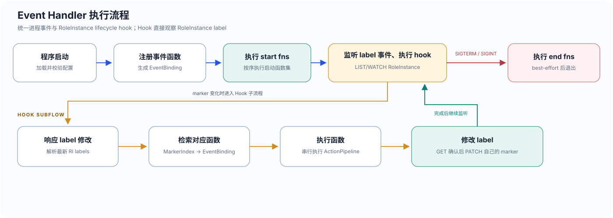

# Proposal 0014: Patio Event Handling and Callback Mechanism

| Item | Content |
| --- | --- |
| Status | draft |
| Date | Created 2026-11-04; updated 2026-11-17 |
| Author | inference-engine-runtime maintainers |
| Reference | sgl-project/rbg#546 (KEP-527 draft) |
| Scope | Unify process events and lifecycle hooks; migrate SGLang and vLLM to the new callback structure |

<!-- toc -->
- [Summary](#summary)
- [Motivation](#motivation)
  - [Background](#background)
  - [Problems](#problems)
  - [Goals](#goals)
  - [Non-Goals](#non-goals)
  - [User Impact](#user-impact)
- [Proposal](#proposal)
  - [Terminology](#terminology)
  - [User Stories](#user-stories)
  - [Recommended Design](#recommended-design)
  - [Detailed Design](#detailed-design)
  - [Configuration](#configuration)
  - [Compatibility](#compatibility)
  - [Observability](#observability)
  - [Security](#security)
  - [Performance and Scalability](#performance-and-scalability)
  - [Risks and Mitigations](#risks-and-mitigations)
  - [Drawbacks](#drawbacks)
  - [Alternatives](#alternatives)
- [Test Plan](#test-plan)
- [Rollout](#rollout)
- [Open Questions](#open-questions)
- [Implementation History](#implementation-history)
- [References](#references)
<!-- /toc -->

## Summary

Patio currently spreads startup, heartbeat, and shutdown logic across `app.py` and `topo/`.

This proposal makes three changes:

1. Add `start`, `end`, and `hook` event entry points.
2. Rewrite SGLang and vLLM startup and shutdown logic as callbacks.
3. Split router protocols and engine checks into independent adapters.

RoleInstance is only one source of `signal`; it is not a required dependency of this proposal.

## Motivation

### Background

The current startup flow is:

```text
Patio starts
  -> derive router / worker / engine endpoints
  -> wait for engine readiness
  -> register
  -> periodically re-register
  -> unregister on SIGTERM / SIGINT
```

### Problems

1. Startup, heartbeat, and shutdown are three separate code paths that write the same router state.
2. SGLang and vLLM differences are hidden in their respective clients, so adding an operation requires understanding both event timing and engine protocol.
3. Users cannot adjust startup, shutdown, or hook behavior by changing configuration only.
4. Startup registration and shutdown cleanup cannot reuse the same business logic, and their timeout and retry policies differ.

### Goals

- [ ] Add `start`, `end`, and `hook` event entry points.
- [ ] Migrate SGLang and vLLM startup and shutdown logic to callbacks.
- [ ] Split router protocols and engine checks into independent adapters.
- [ ] Preserve current behavior when `event_callbacks` is not configured.
- [ ] Let users change event bindings through `events.yaml` only.

### Non-Goals

1. Do not modify the RBG API, RoleInstance spec, or controller state machine.
2. Do not implement executor election, leases, or authorization.
3. Do not manage Pod finalizers or deletion order.
4. Do not define member discovery for multi-Pod RoleInstances.
5. Do not implement custom drain checks.

### User Impact

| User | Impact |
| --- | --- |
| Kubernetes operators | Can adjust startup, shutdown, and hook behavior through `events.yaml`. |
| SGLang / vLLM integrators | Add an operation by implementing a callback, not by modifying the event scheduler. |
| Patio maintainers | Event execution, router protocol, and engine checks are separate and easier to test and evolve. |

## Proposal

### Terminology

| Term | Meaning |
| --- | --- |
| `signal` | A `key=value` trigger condition, such as `patio.com/router=offboard`. |
| `signalLabel` | A key/value pair in RoleInstance labels; it is the Kubernetes representation of a `signal`. |
| `callback` | An asynchronous business operation, such as waiting for engine readiness or registering with a router. Users reference it by name. |
| `hook` binding | A mapping from one `signal` to one `callback`. |
| `start` / `end` | Ordered callback lists executed at process startup and on termination. |
| Event executor | The runtime module that schedules callbacks in configuration order, matches `signal` values, and handles retries. |
| Router adapter | An object that encapsulates SGLang router and vLLM proxy registration protocols and provides `add`, `remove`, and `query`. |
| Engine probe | An object that encapsulates engine readiness and quiescence checks and provides `ready` and `quiescent`. |
| Orchestration system | The external system that triggers a `signal`, such as RBG. |
| RBG | Role-Based Group, the higher-level system that manages RoleInstance objects. |
| `preUpdate` / `preDelete` / `postReady` | RBG lifecycle hook phases. This proposal's `hook` does not use those names directly. |

### User Stories

#### Story 1

```text
As a Kubernetes operator,
I want to register a worker with the router only after the engine is ready,
so the service does not receive traffic too early.
```

#### Story 2

```text
As an SGLang / vLLM integration developer,
I want to add a business operation by implementing only a callback,
so I do not need to modify the event scheduler or router protocol code.
```

### Recommended Design



The event executor uniformly handles `start`, `end`, and `hook`:

```text
Patio starts
  -> explicitly import trusted callback modules
  -> read and validate events.yaml
  -> resolve callback names to function references
  -> execute start callbacks in order
  -> enter the event loop
       -> observe signal
       -> match hooks in configured order
       -> execute the matching callback
       -> clear the signal after success and continue
  -> receive SIGTERM / SIGINT
       -> execute end callbacks in order within the deadline
```

### Detailed Design

#### Event Flow

1. `start` and `end` execute serially in configuration order.
2. `hook` entries are checked in configuration order; matched entries execute serially and never in parallel.
3. The executor proceeds to the next binding only after the current callback succeeds and the `signal` removal is confirmed.
4. If a callback or `signal` removal fails, the state is retained, processing stops for the current round, and the executor retries with bounded backoff.
5. Callbacks must be idempotent and safe to retry.

#### Directory Structure

```text
patio/
├── app.py
├── application.py
├── api/
├── metrics/
├── events/
│   ├── __init__.py
│   ├── registry.py
│   ├── loader.py
│   ├── executor.py
│   ├── models.py
│   └── plugins/
│       ├── __init__.py
│       ├── sglang.py
│       └── vllm.py
├── adapters/
│   ├── __init__.py
│   ├── router/
│   │   ├── __init__.py
│   │   ├── base.py
│   │   ├── sglang.py
│   │   └── vllm.py
│   └── engine/
│       ├── __init__.py
│       ├── base.py
│       ├── sglang.py
│       └── vllm.py
├── lifecycle/
│   ├── __init__.py
│   └── signal_label.py
└── config.py
```

| Directory | Responsibility |
| --- | --- |
| `events/` | Event executor, callback registry, configuration loading, and plugin import |
| `events/plugins/` | SGLang / vLLM callback implementations |
| `adapters/router/` | SGLang router and vLLM proxy registration protocols |
| `adapters/engine/` | Engine readiness, drain, and metric checks |
| `lifecycle/` | RoleInstance `signalLabel` observation and clearing |
| `application.py` | Assembles the objects above and manages process startup and shutdown |

Current code migrates to the new structure as follows:

| Current | New Location |
| --- | --- |
| `src/patio/app.py` | `application.py` + `events/executor.py` |
| `src/patio/topo/client/sgl_topo_client.py` | `events/plugins/sglang.py` + `adapters/router/sglang.py` |
| `src/patio/topo/client/vllm_topo_client.py` | `events/plugins/vllm.py` + `adapters/router/vllm.py` |
| `src/patio/topo/factory.py` | Assembly logic under `adapters/router/` |
| `src/patio/engine/` | Keep business capabilities; add `adapters/engine/` for event-side readiness and quiescence checks |

#### Callback Mechanism

Each callback provides one asynchronous operation and is unaware of event names or `signal` values:

```python
from collections.abc import Awaitable, Callable


EventCallback = Callable[[], Awaitable[None]]
callback_plugins: dict[str, EventCallback] = {}


def register_callback(name: str) -> Callable[[EventCallback], EventCallback]:
    def decorator(callback: EventCallback) -> EventCallback:
        if name in callback_plugins:
            raise ValueError(f"Callback plugin already registered: {name}")
        callback_plugins[name] = callback
        return callback

    return decorator
```

Registration rules:

1. `callback_plugins` and `register_callback` live in a shared registry module.
2. The decorator records the function reference at plugin import time and does not execute business logic; duplicate names fail immediately.
3. The application explicitly imports trusted plugin modules, then validates user configuration and builds event bindings.
4. YAML references registered names only; it does not dynamically import Python modules.
5. Shared dependencies such as router adapters and engine probes can be bound before registration.
6. The same callback may be used in `start`, `end`, and multiple `hook` bindings.

#### Engine Integration

Startup, heartbeat, and shutdown logic in the current SGLang and vLLM clients is split into callbacks:

| Engine | Callback | Main Operation |
| --- | --- | --- |
| SGLang | `engine_wait_ready` | Wait for engine readiness |
| SGLang | `router_onboard` | Register the worker |
| SGLang | `router_offboard` | Stop heartbeat, unregister, and wait for drain |
| vLLM | `engine_wait_ready` | Wait for engine readiness |
| vLLM | `router_onboard` | Call the proxy add API |
| vLLM | `router_offboard` | Call the proxy remove API and wait for drain |

Router operations and engine checks are handled by Router adapters and Engine probes. Callbacks describe business actions and do not branch on engine protocol internally.

#### RoleInstance Integration

RoleInstance is the object RBG manages, and `signalLabel` is a key/value pair in its labels.

`signal` can originate from `signalLabel`. RBG writes `patio.com/router: offboard` to the RoleInstance and projects it to Pod labels; Patio reads it and matches `patio.com/router=offboard` against hooks.

After a callback succeeds, the event executor clears the corresponding RoleInstance label through the Kubernetes API. Callbacks do not maintain Kubernetes objects directly.

#### Error Handling

| Failure | Handling |
| --- | --- |
| Unregistered callback name | Fail during startup before executing any callback. |
| Callback execution failure | Retain the `signal`, stop the current round, and retry with backoff. |
| `signal` removal failure | Retain the `signal` and confirm again in the next round. |
| Timeout | Retain state, log, and alert. |

### Configuration

Users declare event bindings in `events.yaml`.

The default path is `/etc/patio/events.yaml`.

```yaml
event_callbacks:
  start:
    - engine_wait_ready
    - router_onboard

  hook:
    - signal: "patio.com/kv-cache=restore"
      callback: kv_cache_restore
    - signal: "patio.com/router=onboard"
      callback: router_onboard
    - signal: "patio.com/router=offboard"
      callback: router_offboard
    - signal: "patio.com/kv-cache=dump"
      callback: kv_cache_dump

  end:
    - router_offboard
```

Configuration semantics:

1. `start` is an ordered list of callback names executed at process startup.
2. `hook` is an ordered list of bindings, each containing one `signal` and one `callback`.
3. `end` is an ordered list of callback names executed on SIGTERM / SIGINT.
4. `start` and `end` do not bind `signal`; they execute callbacks in order.
5. Omitting a section or providing an empty list means no callbacks are registered for it.
6. Removing a hook binding stops processing that `signal`.
7. To execute multiple operations, configure separate `signal` values and have the orchestration system set them together.
8. `hook` does not use `preUpdate`, `preDelete`, or `postReady` names and has no `enabled` field.
9. `start` does not wait for `postReady`. If a business operation must run after workload readiness, use `hook` and have the orchestration system write the corresponding `signal` after readiness.
10. If multiple `signal` values have an ordering requirement, the orchestration system should write them in the same update and hand them to the same event executor.

Validation rules:

1. Reject unknown fields, unknown plugins, invalid `signal` values, and duplicate `signal` bindings.
2. `start` and `end` must be name lists.
3. Each `hook` entry must contain `signal` and exactly one `callback`.
4. Empty lists are valid.

### Compatibility

1. Without `event_callbacks`, preserve existing startup registration behavior.
2. `start`, `end`, and `hook` use the same event executor; the separate heartbeat thread and shutdown handler are removed.
3. Do not introduce a new registration mode switch.
4. Existing `TOPO_TYPE`, `INFERENCE_ENGINE`, and endpoint configuration continue to select router and engine behavior.
5. `topo/server` remains unchanged.

In particular:

- `TOPO_TYPE` currently selects the SGLang / vLLM registration protocol.
- `INFERENCE_ENGINE` currently selects the engine probe implementation.

### Observability

| Type | Content |
| --- | --- |
| Logs | Callback name, `signal`, execution result, retry count, and duration. |
| Metrics | `patio_event_callback_duration_seconds` (Histogram, label `callback`) and `patio_event_signal_state` (Gauge, label `signal`). |
| Health check | `/health` still reflects the Patio process only and does not check the engine. |

### Security

1. Callback modules must be explicitly imported; do not dynamically load Python files from YAML.
2. `events.yaml` references registered names only.
3. Do not log tokens, secrets, or full request payloads.

### Performance and Scalability

1. `start`, `hook`, and `end` execute serially, preventing concurrent writes to the same router state.
2. Each round processes one `signal` binding; failures retry with bounded backoff.
3. Callbacks should avoid indefinite waits; the event executor owns timeouts and retries.

### Risks and Mitigations

| Risk | Impact | Detection | Mitigation |
| --- | --- | --- | --- |
| Callback name is misspelled | Startup fails | Startup logs | Validate configuration before execution and fail on unknown names. |
| `signal` removal fails | Hook state remains | Metrics and logs | Retain the `signal`, retry, and do not overwrite completed state. |
| Callback runs too long | Later events are blocked | Timeout metrics | Apply separate timeouts and backoff for `start`, `hook`, and `end`. |
| User configures an unreasonable order | Business operations run in the wrong order | Integration tests | Document ordering semantics; validation checks structure, not business intent. |

### Drawbacks

1. The event abstraction adds a layer that requires understanding configuration and registry relationships during debugging.
2. Callbacks must be idempotent, which is an implementation constraint.
3. Serial execution reduces throughput but makes router-state changes easier to reason about.

### Alternatives

#### Keep the current structure

This is the smallest change, but startup, heartbeat, and shutdown remain separate code paths that write the same router state, and adding engines or operations still requires edits in multiple places.

#### Add hooks directly to existing clients

This is faster to implement, but event timing and engine protocol remain coupled, and users still cannot adjust behavior through configuration alone.

#### Use a general plugin system

This is more extensible, but requires a more complex plugin lifecycle and dependency injection model, which is out of scope.

## Test Plan

### Unit Tests

1. Callback registry.
2. Configuration validation and name resolution.
3. Execution order of `start`, `hook`, and `end`.
4. `signal` matching, serial execution, and retries.

### Integration Tests

1. Use fake router adapters and fake engine probes to verify SGLang / vLLM callbacks.
2. Verify RoleInstance `signalLabel` write, observe, and clear behavior.

### End-to-End Tests

1. Use real SGLang and vLLM to verify startup, onboarding, offboarding, and shutdown.
2. Verify that behavior without `event_callbacks` matches the current implementation.

### Failure and Adversarial Tests

1. Callback timeout.
2. `signal` removal failure.
3. Configuration references a callback that does not exist.
4. The same `signal` is triggered repeatedly.

## Rollout

1. Implement the callback registry and event executor while preserving current startup behavior.
2. Migrate SGLang and vLLM.
3. Integrate RoleInstance `signalLabel`.

## Open Questions

1. Whether to provide built-in default callbacks so users only change `signal` values.
2. Whether `signal` should support only `key=value` or richer match expressions.

## Implementation History

| Date | Event |
| --- | --- |
| 2026-11-04 | Initial draft. |
| 2026-11-17 | Reworked as the event handling and callback mechanism proposal. |

## References

1. sgl-project/rbg#546
2. `.agent/lifecycle/event-handler-design.md`
3. `.agent/architecture.md`
4. `.agent/wiki/03-code-structure.md`
5. `proposals/README.md`
6. `event-handler-flow.svg`
