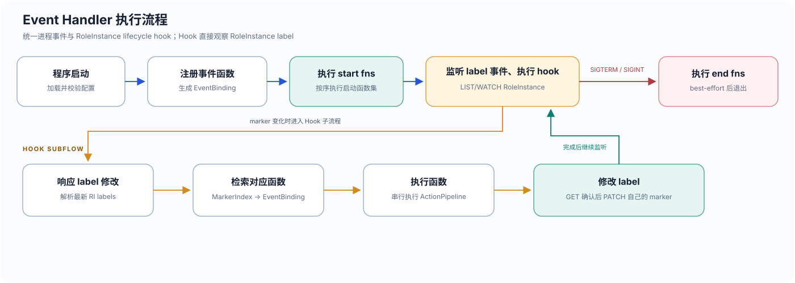

# 提案 0014：Patio 事件处理与 Callback 机制

| 条目 | 内容 |
| --- | --- |
| 状态 | 草案 |
| 日期 | 创建于 2026-11-04；更新于 2026-11-17 |
| 作者 | inference-engine-runtime maintainers |
| 参考 | sgl-project/rbg#546（KEP-527 草案） |
| 范围 | 统一进程事件与生命周期 Hook；SGLang、vLLM 迁移到新的 Callback 结构 |

<!-- toc -->
- [概述](#概述)
- [动机](#动机)
  - [背景](#背景)
  - [问题](#问题)
  - [目标](#目标)
  - [非目标](#非目标)
  - [用户影响](#用户影响)
- [方案](#方案)
  - [术语](#术语)
  - [用户故事](#用户故事)
  - [推荐方案](#推荐方案)
  - [详细设计](#详细设计)
  - [配置](#配置)
  - [兼容性](#兼容性)
  - [可观测性](#可观测性)
  - [安全](#安全)
  - [性能与可扩展性](#性能与可扩展性)
  - [风险与缓解](#风险与缓解)
  - [缺点](#缺点)
  - [备选方案](#备选方案)
- [测试计划](#测试计划)
- [发布顺序](#发布顺序)
- [开放问题](#开放问题)
- [实施历史](#实施历史)
- [参考](#参考)
<!-- /toc -->

## 概述

Patio 目前把启动、心跳和退出逻辑分散在 `app.py` 和 `topo/` 中。本提案包含三类变化：

1. 新增 `start`、`end`、`hook` 三类事件入口。
2. 把 SGLang 和 vLLM 的启动、退出逻辑改写成 Callback。
3. 把路由协议和引擎检查拆到独立 adapter。

RoleInstance 只是 `signal` 的一种来源，不是本提案的必要依赖。

## 动机

### 背景

当前启动流程是：

```text
Patio 启动
  -> 推导 router / worker / engine 地址
  -> 等待 engine ready
  -> 注册
  -> 周期性重注册
  -> SIGTERM / SIGINT 时反注册
```

### 问题

1. 启动、心跳和退出是三段独立代码，却写同一个路由状态。
2. SGLang 和 vLLM 的差异封装在各自的 client 中，新增一个操作需要同时理解事件时机和引擎协议。
3. 用户无法只改配置来调整启动、退出或 hook 阶段的操作。
4. 启动注册和退出清理不能复用同一段业务逻辑，重试和超时策略也不一致。

### 目标

- [ ] 新增 `start`、`end`、`hook` 三类事件入口。
- [ ] 把 SGLang 和 vLLM 的启动、退出逻辑迁移到 Callback。
- [ ] 把路由协议和引擎检查拆成独立 adapter。
- [ ] 保持未配置 `event_callbacks` 时的现有行为。
- [ ] 支持用户只通过 `events.yaml` 调整事件绑定。

### 非目标

1. 不修改 RBG API、RoleInstance spec 或 controller 状态机。
2. 不实现 executor 选举、lease 或授权。
3. 不管理 Pod finalizer 或删除顺序。
4. 不定义多 Pod RoleInstance 的成员发现协议。
5. 不实现业务自定义 drain 检查。

### 用户影响

| 用户 | 影响 |
| --- | --- |
| Kubernetes 运维人员 | 可以通过 `events.yaml` 调整启动、退出和 hook 行为。 |
| SGLang / vLLM 集成开发者 | 新增操作时只需实现 Callback，不用修改事件调度器。 |
| Patio 维护者 | 事件执行、路由协议和引擎检查分离，便于测试和演进。 |

## 方案

### 术语

| 术语 | 含义 |
| --- | --- |
| `signal` | `key=value` 形式的触发条件，例如 `patio.com/router=offboard`。 |
| `signalLabel` | RoleInstance labels 中的一个 key/value，是 `signal` 在 Kubernetes 中的载体。 |
| `callback` | 一个异步业务操作，例如等待引擎就绪、注册路由。用户通过名称引用它。 |
| `hook` 绑定 | 一条 `signal` 和一个 `callback` 的对应关系。 |
| `start` / `end` | 进程启动、收到终止信号时按顺序执行的 Callback 列表。 |
| 事件执行器 | 按配置顺序调度 Callback、匹配 `signal` 并处理重试的运行时模块。 |
| Router adapter | 封装 SGLang router、vLLM proxy 注册协议的对象，提供 `add`、`remove`、`query`。 |
| Engine probe | 封装引擎 ready 和排空检查的对象，提供 `ready`、`quiescent`。 |
| 编排系统 | 触发 `signal` 的外部系统，例如 RBG。 |
| RBG | Role-Based Group，管理 RoleInstance 的上层系统。 |
| `preUpdate` / `preDelete` / `postReady` | RBG lifecycle hook 的阶段名。本提案的 `hook` 不直接使用这些名称。 |

### 用户故事

#### 故事 1

```text
作为 Kubernetes 运维人员，
我希望在引擎就绪后再把 worker 注册到 router，
这样服务启动时不会过早接收流量。
```

#### 故事 2

```text
作为 SGLang / vLLM 集成开发者，
我希望新增一个业务操作时只实现一个 Callback，
这样不用修改事件调度器和路由协议代码。
```

### 推荐方案



事件执行器统一处理 `start`、`end`、`hook`：

```text
Patio 启动
  -> 显式导入受信任的 Callback 模块
  -> 读取并校验 events.yaml
  -> 把 Callback 名称解析成函数引用
  -> 按顺序执行 start Callback
  -> 进入事件循环
       -> 观察 signal
       -> 按 hook 列表顺序匹配
       -> 执行匹配的 Callback
       -> 成功后清除 signal 并继续观察
  -> 收到 SIGTERM / SIGINT
       -> 在限定时间内按顺序执行 end Callback
```

### 详细设计

#### 事件流程

1. `start` 和 `end` 按配置顺序串行执行。
2. `hook` 按 `hook` 列表的配置顺序检测；匹配的条目串行执行，不并行。
3. 当前 Callback 成功且 `signal` 清除确认后，才继续处理下一项。
4. Callback 或 `signal` 清除失败时保留状态，本轮停止后续处理并按策略重试。
5. Callback 必须支持幂等重试。

#### 目录结构

```text
patio/
├── app.py
├── application.py
├── api/
├── metrics/
├── events/
│   ├── __init__.py
│   ├── registry.py
│   ├── loader.py
│   ├── executor.py
│   ├── models.py
│   └── plugins/
│       ├── __init__.py
│       ├── sglang.py
│       └── vllm.py
├── adapters/
│   ├── __init__.py
│   ├── router/
│   │   ├── __init__.py
│   │   ├── base.py
│   │   ├── sglang.py
│   │   └── vllm.py
│   └── engine/
│       ├── __init__.py
│       ├── base.py
│       ├── sglang.py
│       └── vllm.py
├── lifecycle/
│   ├── __init__.py
│   └── signal_label.py
└── config.py
```

| 目录 | 职责 |
| --- | --- |
| `events/` | 事件执行器、Callback 注册表、配置加载和插件导入 |
| `events/plugins/` | SGLang / vLLM 的具体 Callback 实现 |
| `adapters/router/` | SGLang router、vLLM proxy 的注册/注销协议 |
| `adapters/engine/` | 引擎 ready、排空和指标检查 |
| `lifecycle/` | RoleInstance `signalLabel` 的观察与清除 |
| `application.py` | 组装上述对象，管理进程启动和停止 |

当前代码迁移到新结构时：

| 现状 | 新位置 |
| --- | --- |
| `src/patio/app.py` | `application.py` + `events/executor.py` |
| `src/patio/topo/client/sgl_topo_client.py` | `events/plugins/sglang.py` + `adapters/router/sglang.py` |
| `src/patio/topo/client/vllm_topo_client.py` | `events/plugins/vllm.py` + `adapters/router/vllm.py` |
| `src/patio/topo/factory.py` | `adapters/router/` 的装配逻辑 |
| `src/patio/engine/` | 保留业务能力，新增 `adapters/engine/` 负责事件侧的 ready / quiescent 检查 |

#### Callback 机制

每个 Callback 只提供一个异步操作，不感知事件名称或 `signal`：

```python
from collections.abc import Awaitable, Callable


EventCallback = Callable[[], Awaitable[None]]
callback_plugins: dict[str, EventCallback] = {}


def register_callback(name: str) -> Callable[[EventCallback], EventCallback]:
    def decorator(callback: EventCallback) -> EventCallback:
        if name in callback_plugins:
            raise ValueError(f"Callback plugin 重复注册：{name}")
        callback_plugins[name] = callback
        return callback

    return decorator
```

注册约定：

1. `callback_plugins` 和 `register_callback` 放在公共注册模块中。
2. 装饰器在插件模块导入时登记函数引用，不执行业务操作；重复名称直接报错。
3. 应用启动时显式导入受信任的插件模块，再校验用户配置并生成事件绑定。
4. YAML 只引用注册名称，不用于动态导入 Python 模块。
5. 需要共享 router adapter、engine probe 等依赖时，可在装配阶段注册绑定依赖后的 callable。
6. 同一个 Callback 可以用于 `start`、`end` 和多个 `hook` 绑定。

#### 引擎集成

现有 SGLang 和 vLLM client 中的启动、心跳和退出逻辑被拆成 Callback：

| 引擎 | Callback | 主要操作 |
| --- | --- | --- |
| SGLang | `engine_wait_ready` | 等待 engine ready |
| SGLang | `router_onboard` | 注册 worker |
| SGLang | `router_offboard` | 停止 heartbeat、注销并等待排空 |
| vLLM | `engine_wait_ready` | 等待 engine ready |
| vLLM | `router_onboard` | 调用 proxy 的 add API |
| vLLM | `router_offboard` | 调用 proxy 的 remove API 并等待 drain |

路由操作和引擎检查分别由 Router adapter 和 Engine probe 承担。Callback 只描述业务动作，不在函数内部区分引擎协议。

#### RoleInstance 集成

RoleInstance 是 RBG 管理的实例对象，`signalLabel` 是它 labels 中的一个 key/value。

`signal` 可以来自 `signalLabel`。RBG 把 `patio.com/router: offboard` 写到 RoleInstance 上，并投影到 Pod 标签；Patio 读取后按 `patio.com/router=offboard` 匹配 hook。

Callback 成功后，由事件执行器通过 API 清除对应的 RoleInstance label。Callback 不直接维护 Kubernetes 对象。

#### 错误处理

| 失败类型 | 处理方式 |
| --- | --- |
| 未注册的 Callback 名称 | 启动阶段直接报错，不执行任何 Callback。 |
| Callback 执行失败 | 保留 `signal`，本轮停止，按退避策略重试。 |
| `signal` 清除失败 | 保留 `signal`，下一轮重新确认。 |
| 超时 | 保留状态，记录日志并告警。 |

### 配置

用户在 `events.yaml` 中声明事件绑定。

默认路径是 `/etc/patio/events.yaml`。

```yaml
event_callbacks:
  start:
    - engine_wait_ready
    - router_onboard

  hook:
    - signal: "patio.com/kv-cache=restore"
      callback: kv_cache_restore
    - signal: "patio.com/router=onboard"
      callback: router_onboard
    - signal: "patio.com/router=offboard"
      callback: router_offboard
    - signal: "patio.com/kv-cache=dump"
      callback: kv_cache_dump

  end:
    - router_offboard
```

配置语义：

1. `start`：进程启动时按顺序执行的 Callback 名称列表。
2. `hook`：按配置顺序检测的绑定列表，每项包含一个 `signal` 和一个 `callback`。
3. `end`：进程收到 SIGTERM / SIGINT 后按顺序执行的 Callback 名称列表。
4. `start` 和 `end` 不绑定 `signal`，只按顺序执行 Callback。
5. 省略某部分或配置空列表表示不注册该部分的操作。
6. 移除某条 hook 绑定即不再处理该 `signal`。
7. 需要执行多个操作时，为各操作分别配置不同的 `signal`，由编排系统同时设置这些 `signal`。
8. `start` 不等待 `postReady`。如果业务需要在工作负载就绪后再上线，应使用 `hook` 并由编排系统在就绪后写入对应 `signal`。
9.  如果多个 `signal` 之间有先后顺序，编排系统应在同一次更新中一起写入这些 `signal`，再交给同一个事件执行器处理。

配置校验规则：

1. 拒绝未知字段、未知 plugin、非法 `signal` 和重复 `signal` 绑定。
2. `start`、`end` 必须是名称列表。
3. `hook` 的每项必须包含 `signal` 和单个 `callback`。
4. 空列表合法。

### 兼容性

1. 未配置 `event_callbacks` 时，保留现有 startup 注册行为。
2. `start`、`end`、`hook` 使用同一个事件执行器，不再保留独立的心跳线程和退出处理函数。
3. 不引入新的注册模式开关。
4. 现有 `TOPO_TYPE`、`INFERENCE_ENGINE` 和 endpoint 配置继续作为路由与引擎选择的输入。
5. `topo/server` 保持不变。

其中：

- `TOPO_TYPE` 是当前用于选择 SGLang / vLLM 注册协议的环境变量。
- `INFERENCE_ENGINE` 是当前用于选择引擎探测实现的环境变量。

### 可观测性

| 类型 | 内容 |
| --- | --- |
| 日志 | Callback 名称、`signal`、执行结果、重试次数和耗时。 |
| 指标 | `patio_event_callback_duration_seconds`（Histogram，标签 `callback`）、`patio_event_signal_state`（Gauge，标签 `signal`）。 |
| 健康检查 | `/health` 仍只反映 Patio 进程状态，不检查引擎。 |

### 安全

1. Callback 模块必须显式导入，不根据 YAML 动态加载 Python 文件。
2. `events.yaml` 只引用已注册名称。
3. 不在日志中输出 token、密钥或完整请求内容。

### 性能与可扩展性

1. `start`、`hook`、`end` 均串行执行，避免并发写同一个路由状态。
2. 每轮只处理一个 `signal` 绑定，失败后按退避策略重试。
3. Callback 内部应避免无限等待，超时和重试由事件执行器统一管理。

### 风险与缓解

| 风险 | 影响 | 检测方式 | 缓解措施 |
| --- | --- | --- | --- |
| Callback 名称拼错 | 启动失败 | 启动日志 | 配置校验在执行前完成，未注册名称直接报错 |
| `signal` 清除失败 | hook 状态残留 | 指标和日志 | 保留 `signal` 并按策略重试，不覆盖已完成状态 |
| Callback 执行时间过长 | 阻塞后续事件 | 超时指标 | 为 `start`、`hook`、`end` 分别设置超时和退避 |
| 用户配置顺序不合理 | 业务操作顺序错误 | 集成测试 | 文档明确顺序语义，校验只检查结构不猜测业务意图 |

### 缺点

1. 引入一层事件抽象，调试时需要先理解配置和注册关系。
2. Callback 必须写成幂等函数，增加了实现约束。
3. 串行执行会降低吞吐，但换来的是更容易推理的路由状态变更。

### 备选方案

#### 保留现有结构

改动最小，但启动、心跳和退出仍是三段独立代码，继续写同一个路由状态，新增引擎或操作时仍要修改多处。

#### 在现有 client 中直接加 hook

实现更快，但事件时机和引擎协议继续耦合在一起，用户仍然无法只改配置调整行为。

#### 使用通用插件系统

扩展性更好，但需要定义更复杂的插件生命周期和依赖注入，超出本提案范围。

## 测试计划

### 单元测试

1. Callback 注册表。
2. 配置校验和名称解析。
3. `start`、`hook`、`end` 的执行顺序。
4. `signal` 匹配、串行执行和重试。

### 集成测试

1. 使用 fake router adapter 和 fake engine probe 验证 SGLang / vLLM Callback。
2. 验证 RoleInstance `signalLabel` 的写入、观察和清除。

### 端到端测试

1. 使用真实 SGLang 和 vLLM 验证启动、上线、下线和退出流程。
2. 验证未配置 `event_callbacks` 时行为与现状一致。

### 故障与对抗测试

1. Callback 执行超时。
2. `signal` 清除失败。
3. 配置中引用不存在的 Callback。
4. 同一个 `signal` 被重复触发。

## 发布顺序

1. 先实现 Callback 注册表和事件执行器，保留现有启动行为。
2. 再迁移 SGLang 和 vLLM。
3. 最后接入 RoleInstance `signalLabel`。

## 开放问题

1. 是否需要内置一组默认 Callback，供用户只改 `signal` 不改名称。
2. `signal` 是否只支持 `key=value`，还是需要支持更复杂的匹配表达式。

## 实施历史

| 日期 | 事件 |
| --- | --- |
| 2026-11-04 | 创建初始草案。 |
| 2026-11-17 | 调整为事件处理与 Callback 机制。 |

## 参考

1. sgl-project/rbg#546
2. `.agent/lifecycle/event-handler-design.md`
3. `.agent/architecture.md`
4. `.agent/wiki/03-code-structure.md`
5. `proposals/README.md`
6. `event-handler-flow.svg`
