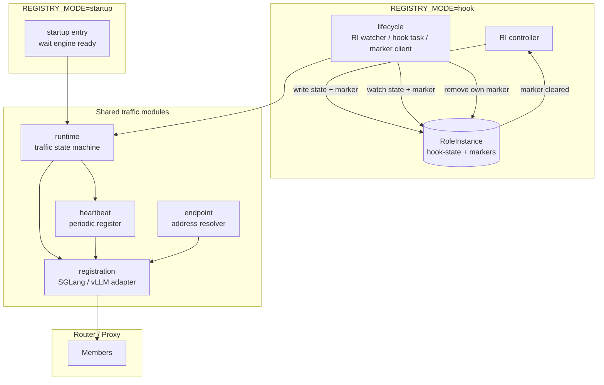

# Proposal 14: Patio as RoleInstance Lifecycle Hook Executor

| Item | Content |
| --- | --- |
| Status | draft |
| Date | Created 2026-11-04; updated 2026-11-06 |
| Author | inference-engine-runtime maintainers |
| Reference | `rbg/keps/527-roleinstance-lifecycle/README.md` |
| Scope | `postReady` bring-up; `preUpdate` / `preDelete` traffic removal and drain |

## Summary

The core terms used in this proposal are: RoleInstance (RI) is RBG's instance-level resource; `postReady`, `preUpdate`, and `preDelete` are instance-level lifecycle hooks defined by RBG; a marker is a hook trigger label written by the controller to the RI; `REGISTRY_MODE` is the environment variable that selects Patio's registration control entry point.

Patio currently registers a worker with the SGLang router or vLLM proxy immediately after startup and maintains membership through periodic re-registration. That behavior conflicts with RBG's instance-level lifecycle coordination: an instance may receive traffic before `postReady`, and may be re-registered after `preUpdate` or `preDelete` has removed it from routing because of a restart or SIGTERM.

This proposal makes registration control configurable through `REGISTRY_MODE`:

```text
REGISTRY_MODE=startup | hook | none
```

The default remains `startup` for compatibility with existing deployments. When set to `hook`, Patio becomes the registration executor for RBG RoleInstance lifecycle hooks: bring-up, removal, and drain are driven by the RoleInstance's `hook-state` and markers, and Patio clears only its own marker after success.

## Motivation

### Current behavior

The current `topo_client` behavior is:

```text
Patio starts
  -> derive router / worker / engine endpoints
  -> wait for engine readiness
  -> register
  -> periodically re-register
  -> unregister on SIGTERM / SIGINT
```

This is suitable for "register on startup" deployments, but not for instances whose lifecycle is controlled by RBG:

1. An instance may be registered and receive traffic before `postReady`.
2. After `preUpdate` or `preDelete` removes traffic, a process restart may re-register it.
3. SIGTERM is a process-level event and does not represent an RBG lifecycle decision.
4. Endpoint derivation, registration protocol, heartbeat, and signal handling are coupled in `topo_client` and `app.py`.

### Goals

1. Preserve existing startup registration behavior by default.
2. Support marker-driven bring-up and removal coordinated by RBG.
3. During removal, stop heartbeat first, wait for the last register call to finish, and then unregister.
4. Establish common drain semantics, with framework differences interpreted by adapters.
5. Clarify responsibility boundaries between RBG, the orchestration system, and Patio.

### Non-Goals

1. Do not modify the RBG API, RoleInstance spec, or controller state machine.
2. Do not implement executor election, leases, or authorization.
3. Do not manage Pod finalizers or Pod deletion ordering.
4. Do not handle `preRecover`.
5. Do not define member discovery or action aggregation for multi-Pod RoleInstances.
6. Do not implement business-custom drain checks; additional business constraints require a separate proposal.

### User Impact

| User | Impact | Action required |
| --- | --- | --- |
| Kubernetes / RBG operators | Can use `REGISTRY_MODE=hook` to let Patio participate in instance-level bring-up, traffic removal, and drain; failed pre-hooks continue to block the operation | Before enabling, deploy the new Patio version, inject the RI name and marker configuration, and grant minimal Kubernetes API permissions |
| Application developers | Patio does not register a worker before `postReady`; after `preUpdate` or `preDelete`, restarts and SIGTERM no longer automatically register it. Traffic recovery depends on the RBG hook and router state | Confirm whether the business has long-lived connections, streaming requests, or additional drain requirements |
| SGLang / vLLM integrators | Registration is split into adapters and must provide confirmable unregister and drain state | Confirm router / proxy APIs and metric semantics |
| Patio maintainers | `topo` responsibilities are split into endpoint, registration, runtime, heartbeat, and lifecycle; Kubernetes watch / patch logic is added | Implement and test the new module boundaries |

## Proposal

### User Stories

```text
As a Kubernetes operator,
I want Patio to register an inference worker only after RBG postReady,
so that the instance does not receive traffic before the controlled operation is ready.
```

```text
As a Kubernetes operator,
I want Patio to stop heartbeat registration, unregister, and drain requests before update or delete,
so that RBG can safely replace or delete the RoleInstance.
```

```text
As an SGLang/vLLM integration developer,
I want registration and drain behavior represented by explicit adapters,
so that framework differences do not leak into the lifecycle state machine.
```

## Terminology

| Term | Meaning |
| --- | --- |
| Patio | The runtime process of this inference-engine-runtime project, running as an inference engine sidecar |
| RoleInstance (RI) | RBG's instance-level resource; one RI represents one inference instance. This proposal initially supports one Pod and one executor |
| `hook-state` | The phase label written by the RBG controller to `rbg.workloads.x-k8s.io/role-instance-hook-state`, such as `PreUpdate`, `PreDelete`, or `PostReady` |
| Marker | A `key=value` RI label that tells an executor to handle a hook; the executor removes its own marker after completion |
| Hook executor | A component that watches markers, performs actions, and clears markers. In this proposal, Patio is the registration hook executor |
| Registration | The protocol for adding or removing a worker from the router or proxy member list |
| Endpoint | The address used to access the router / proxy, worker, or engine health |
| Heartbeat | A self-healing mechanism that periodically calls register to recover after router restart |
| Drain | After removal from the router / proxy, waiting for assigned requests to complete |
| Fail closed | When the result cannot be confirmed, remain blocked and do not clear the marker, allowing the controller to continue waiting |
| `REGISTRY_MODE` | Patio environment variable selecting the registration control entry point: startup registration, hook-driven registration, or no registration |

## 1. Architecture Changes

### 1.1 Current architecture

The current `topo_client` is responsible for:

- endpoint derivation;
- engine health waiting;
- register / unregister;
- heartbeat re-registration;
- SIGTERM unregistration.

It is neither an RI-level traffic controller nor a lifecycle executor.

### 1.2 Target architecture



Startup and hook are mutually exclusive entry points: startup directly drives the traffic runtime, while hook drives it through lifecycle markers. They share runtime, heartbeat, registration, and endpoint. `REGISTRY_MODE=none` has no entry point and performs no registration actions.

### 1.3 Directory changes

`api/`, `engine/`, and `metrics/` are unrelated to this proposal and remain unchanged.

Current structure:

```text
patio/
├── app.py
├── envs.py
├── api/
├── engine/
├── metrics/
└── topo/
    ├── client/
    │   ├── base_topo_client.py
    │   ├── sgl_topo_client.py
    │   └── vllm_topo_client.py
    ├── factory.py
    ├── server/
    └── utils.py
```

Target structure:

```text
patio/
├── app.py
├── envs.py
├── api/
├── engine/
├── metrics/
├── lifecycle/
├── runtime/
│   └── heartbeat/
├── registration/
└── endpoint/
```

Migration:

| Current | Target | Change |
| --- | --- | --- |
| `topo/client/*` | `registration/` | Retain only SGLang / vLLM membership protocol |
| Address derivation in `topo/utils.py` | `endpoint/` | Independently derive router / worker / engine endpoints |
| Heartbeat loop in `app.py` | `runtime/heartbeat/` | Encapsulate startable / stoppable periodic register |
| Startup and signal orchestration in `app.py` | `runtime/` | Drive startup / hook / none according to `REGISTRY_MODE` |
| New | `lifecycle/` | Watch RI, match markers, schedule actions, and delete markers |
| `topo/server/` | Unchanged | Not on the hook executor main path |

### 1.4 Module boundaries

| Module | Responsibility | Not responsible for |
| --- | --- | --- |
| `lifecycle` | Watch RI, match hooks, schedule actions, delete markers | Router protocol, finalizers, authorization |
| `runtime` | Bring-up / removal state machine, latest hook-state preemption, task retry | Kubernetes API |
| `registration` | SGLang / vLLM register / unregister protocol | Deciding when to call it |
| `endpoint` | Derive router / worker / engine addresses | Registration protocol |
| `heartbeat` | Start / stop encapsulation for periodic register | Lifecycle decisions |

### 1.5 Registration semantics

Registration encapsulates only the membership protocol:

```text
register
unregister
status
```

SGLang membership identity:

```text
stable logical identity = worker endpoint
worker_id = router-internal handle
```

Patio does not persist `worker_id`. The SGLang router supports listing workers; `unregister` lists current members, finds members by stable worker endpoint, removes them, and repeats until the list confirms the member no longer exists. A missing member is an idempotent success; if member state cannot be confirmed, fail closed and do not clear the marker. If one endpoint maps to multiple logical members, all matches must be removed.

vLLM membership identity:

```text
register   -> POST /instances/add
unregister -> POST /instances/remove
```

The vLLM proxy already provides `/instances/remove`. The current Patio implementation treats `unregister` as a no-op and must be updated. If remove fails or its result cannot be confirmed, fail closed and do not clear the marker.

### 1.6 Endpoint and heartbeat

Endpoint derivation is independent of the registration protocol and derives:

```text
router / proxy endpoint
worker endpoint
engine health endpoint
```

Heartbeat is a self-healing periodic register, not a removal controller:

1. `start()` periodically calls register;
2. after `stop()`, no new register is scheduled;
3. start / stop is idempotent;
4. `preUpdate` / `preDelete` stops heartbeat first;
5. wait for the last register request to finish before unregistering;
6. `postReady` starts heartbeat after registration.

While heartbeat is running, a failed register can be retried by the next heartbeat; the registration primitive does not need an additional long retry.

## 2. RBG and Patio Hook Executor Coordination

### 2.1 Kubernetes API protocol

Patio accesses a fixed resource and does not make the GVR or state key configurable:

```text
group:   workloads.x-k8s.io
version: v1alpha2
kind:    RoleInstance
plural:  roleinstances
scope:   Namespaced
```

The lifecycle hook-state label is fixed to the KEP-527 normative value:

```text
rbg.workloads.x-k8s.io/role-instance-hook-state
```

Patio handles only the three states in this proposal:

```text
PreUpdate
PreDelete
PostReady
```

`Updating`, `Recovering`, `Terminating`, `Running`, and unknown states do not trigger Patio registration actions. The old RoleInstanceSet state machine label `rbg.workloads.x-k8s.io/role-instance-lifecycle-state` is not part of this protocol.

### 2.2 Coordination flow

When `REGISTRY_MODE=hook`:

1. The RBG controller writes `hook-state` and the marker when entering a hook phase.
2. Patio watches the specified RoleInstance.
3. An action is executed only when both `hook-state` and the marker match.
4. Before an action with side effects, Patio GETs the latest RI and reconfirms state and marker.
5. Patio performs register / unregister / drain.
6. On success, Patio deletes only its own marker.
7. The RBG controller decides whether to continue based on whether the marker still matches.

Protocol boundaries:

- The controller does not call Patio's HTTP API.
- Patio does not report business results to the controller.
- If a pre-hook fails, the marker remains and the controller continues waiting.
- `postReady` is asynchronous and does not block the RI phase from entering `Running` or RI Ready.
- RBG may configure multiple markers for a hook; Patio handles only one of them.
- One marker is used by one executor; duplicate assignment is a deployment configuration error.

"GET and recheck before execution" is not a distributed lock; it only reduces the effect of stale watch events. A state-change window remains between GET and action. That window relies on the controller's state transition contract, marker ownership, action idempotency, and latest hook-state preemption semantics.

### 2.3 Marker deletion

Marker deletion uses an idempotent JSON Merge Patch:

```json
{
  "metadata": {
    "labels": {
      "patio.engine/update-block": null
    }
  }
}
```

Before deletion, confirm from the latest watch object, local cache, or GET:

```text
hook-state matches
marker key/value matches
```

If either does not match, do not PATCH. If the marker is already absent, treat it as cleaned or expired. "Read latest object + PATCH" is not a strong concurrency lock; this design accepts the window and assumes one marker is used by one executor.

### 2.4 `preDelete` responsibility boundary

The RBG controller and orchestration system guarantee the `preDelete` deletion sequence:

1. The RBG controller injects, waits for, and clears the Pod finalizer.
2. The RBG controller does not delete the business Pod before the marker is cleared.
3. The deployment system is responsible for executor / sidecar availability and recovery.
4. Patio only performs traffic removal, drain, and unregister.
5. Patio does not inject, delete, or validate Pod finalizers and does not guarantee sidecar liveness.

If the executor is unavailable, the marker remains and the controller continues waiting. Direct external Pod deletion does not trigger preDelete and follows RBG Recovery semantics.

## 3. Environment Variables and Control

### 3.1 `REGISTRY_MODE`

`REGISTRY_MODE` selects Patio's registration control entry:

```text
REGISTRY_MODE=startup | hook | none
```

Default:

```text
REGISTRY_MODE=startup
```

| Mode | Meaning |
| --- | --- |
| `startup` | Preserve current behavior: wait for engine readiness on startup, register, and start heartbeat; do not process lifecycle markers |
| `hook` | This instance is the designated registration hook executor: do not register on startup, do not start heartbeat, and drive register / unregister / drain from markers while clearing only this executor's marker |
| `none` | Do not register, start heartbeat, or process lifecycle markers |

`hook` and `startup` are mutually exclusive, preventing a restart after traffic removal from being re-registered by startup logic.

The RBG / orchestration system designates the hook executor by injecting `REGISTRY_MODE=hook`. Patio performs no election, lease, or authorization. Other Pods' Patio instances use `REGISTRY_MODE=none`.

### 3.2 Environment variables

| Variable | Required | Meaning |
| --- | --- | --- |
| `REGISTRY_MODE` | Optional; default `startup` | Registration control mode |
| `LIFECYCLE_RI_NAME` | Required when `REGISTRY_MODE=hook` | RoleInstance name to watch |
| `LIFECYCLE_PRE_UPDATE_MARKER` | At least one marker in hook mode | `preUpdate` trigger marker |
| `LIFECYCLE_POST_READY_MARKER` | At least one marker in hook mode | `postReady` trigger marker |
| `LIFECYCLE_PRE_DELETE_MARKER` | At least one marker in hook mode | `preDelete` trigger marker |
| `LIFECYCLE_DRAIN_CHECK_INTERVAL` | Optional; default `1s` | Drain snapshot polling interval |
| `LIFECYCLE_DRAIN_STABLE_SAMPLES` | Optional; default `3` | Number of consecutive successful idle snapshots required before declaring idle |

Marker examples:

```text
LIFECYCLE_PRE_UPDATE_MARKER=patio.engine/update-block=true
LIFECYCLE_POST_READY_MARKER=patio.engine/ready-block=true
LIFECYCLE_PRE_DELETE_MARKER=patio.engine/delete-block=true
```

Rules:

1. A marker is a `key=value` string.
2. Kubernetes label keys and values do not contain `=`; split on the first `=`.
3. Reject startup when `=` is missing, the key is empty, or the label syntax is invalid.
4. An unset variable disables that hook for this executor; it does not mean Patio must validate whether RBG configured the hook.
5. In hook mode, at least one marker must be configured; configuring no markers at all is a Patio configuration error and must reject startup.
6. Patio observes, handles, and deletes only its own configured markers.

When `REGISTRY_MODE=hook`, `LIFECYCLE_RI_NAME` must be injected. Patio derives the current namespace from the Pod service account and accesses only that RoleInstance in that namespace; it provides no cross-namespace configuration. Patio does not inject or read the RI UID and does not discover members through owner references or labels. Which member runs the executor is controlled by the deployment through `REGISTRY_MODE`.

This proposal does not handle UID fencing for same-name RI delete/recreate. RBG's preDelete finalizer ensures the old RI completes deletion before a replacement object is created; Patio's register, unregister, and marker cleanup actions must also be idempotent and safely replayable.

The source of marker configuration is `lifecycle.labelsHandler` on the RBG Role. Long term, RBG / orchestration should inject marker environment variables from the effective lifecycle configuration to avoid duplicate configuration; manual injection remains allowed for now. A mismatch with RBG's effective configuration is a deployment error.

### 3.3 Signal behavior

SIGTERM / SIGINT semantics:

| Mode | Behavior |
| --- | --- |
| `startup` | Stop heartbeat, best-effort unregister, then exit |
| `hook` | Stop heartbeat and local tasks, then exit directly; do not unregister or clear markers |
| `none` | Exit directly; perform no registration actions |

In hook mode, a signal cannot represent an RBG lifecycle state and must not trigger unregister outside hook control. If a signal interrupts an unfinished pre-hook, the marker remains and recovery is delegated to RBG orchestration.

## 4. Execution Logic and Pseudocode

The code below is pseudocode illustrating ordering and module interaction, not final interfaces.

### 4.1 Startup entry

```python
def run(config):
    endpoints = endpoint_resolver.resolve()
    registration_adapter = registration.create(config.protocol, endpoints)
    heartbeat = Heartbeat(registration_adapter.register)
    runtime = TrafficRuntime(registration_adapter, heartbeat)

    if config.registry_mode == "startup":
        runtime.startup()
    elif config.registry_mode == "hook":
        lifecycle.run(
            role_instance_name=config.lifecycle_ri_name,
            markers=config.lifecycle_markers,
            runtime=runtime,
        )
    elif config.registry_mode == "none":
        return
```

Startup mode:

```python
async def startup(self):
    await self.engine.wait_ready()
    await self.registration.register()
    self.heartbeat.start()
```

Hook mode does not register or start heartbeat on startup; it only waits for RI events.

### 4.2 RI event dispatch

```python
async def run(role_instance_name, markers, runtime):
    async for event in watch_role_instance(role_instance_name):
        runtime.cancel_hook_if_state_changed(event.state)

        if event.state == "PostReady" and event.matches(markers.post_ready):
            await handle_post_ready(event, runtime, markers.post_ready)

        elif event.state in ("PreUpdate", "PreDelete"):
            if event.state == "PreUpdate" and event.matches(markers.pre_update):
                await handle_pre_hook(event, runtime, markers.pre_update)
            elif event.state == "PreDelete" and event.matches(markers.pre_delete):
                await handle_pre_hook(event, runtime, markers.pre_delete)
```

Both `hook-state` and marker must match. An old marker alone cannot trigger an action.

Patio uses "latest hook-state wins" preemption. After observing a new hook-state, the old local hook task stops advancing: it does not clean the old marker; in-flight register / unregister requests are canceled or allowed to finish at the primitive level, but later steps are not executed. The new state and marker then schedule the new action. Patio does not override controller state with local priority rules. The controller is responsible for valid state transitions and when new states are written; invalid transitions are controller / configuration problems, not Patio decisions.

### 4.3 `postReady` bring-up

Trigger:

```text
hook-state=PostReady
postReady marker matches
```

```python
async def handle_post_ready(event, runtime, marker):
    await runtime.register()
    runtime.heartbeat.start()
    runtime.set_serving()
    await marker.clear_if_still_matching(event)
```

Rules:

1. Confirm engine readiness; RBG workload Ready is the controller's view, while Patio still uses local engine health before registration.
2. Complete registration.
3. Start heartbeat.
4. Enter serving.
5. Clear the executor's own marker.
6. On failure, keep the marker and retry with bounded backoff.

`postReady` does not block the controller from setting phase to `Running`. Whether business traffic recovers is determined by router / proxy state.

### 4.4 `preUpdate` / `preDelete` traffic removal and drain

Trigger:

```text
hook-state=PreUpdate / PreDelete
corresponding marker matches
```

```python
async def handle_pre_hook(event, runtime, marker):
    runtime.begin_drain()

    await runtime.heartbeat.stop(wait_inflight=True)
    await runtime.unregister()
    await runtime.wait_until_drained()

    await marker.clear_if_still_matching(event)
```

Execution order:

```text
preUpdate / preDelete marker
  -> heartbeat.stop()
  -> wait for last register
  -> unregister
  -> wait for drain
  -> clear own marker
```

If any step fails or returns `unknown`, keep the marker, record the failed phase, and replay the idempotent action with bounded backoff; failed steps cannot be skipped. Heartbeat must not start during backoff, and a pre-hook cannot be cleaned as successful.

All hook actions must be idempotent, replayable, and cancellable. After an old task is interrupted:

1. Do not clean an old marker that no longer matches the current state.
2. Register / unregister side effects already produced are converged by the action for the new state or later replay.
3. A marker may be cleaned only when the current `hook-state` and marker still match.
4. The controller is responsible for valid state transition ordering, preventing normal postReady from being abnormally preempted by a pre-hook.

High-level success conditions:

1. The router / proxy member is removed, or confirmed never to have existed.
2. No new register / heartbeat is scheduled after unregister.
3. The inference framework adapter reports drain state `idle`.
4. `idle` remains stable for the configured window.
5. Business-custom drain checks are not executed in the first version; additional business constraints require a future extension.
6. State and marker still match immediately before marker deletion.

### 4.5 Drain snapshot

The runtime defines common drain semantics; each inference framework adapter interprets what is active, queued, or drained.

```text
state: idle | draining | unknown | unsupported
active_requests: number | unknown
queued_requests: number | unknown
swapped_requests: number | unknown | not-applicable
source: sglang-metrics | vllm-metrics | engine-api
```

Rules:

1. `unknown` and `unsupported` cannot be considered idle.
2. If `/metrics` is reachable but a required metric is absent, return `unsupported`; for network failure, timeout, 5xx, parse failure, or NaN, return `unknown`.
3. If a framework cannot provide drain state, the pre-hook fails closed.
4. Idle requires active / queued / swapped to remain zero for `LIFECYCLE_DRAIN_STABLE_SAMPLES` consecutive snapshots.
5. Fetch failure, parse failure, or `unknown` resets the stable sample count.
6. This proposal provides no automatic timeout or automatic release; persistent failure keeps the marker and requires explicit operator handling.
7. Business-custom drain checks are unsupported in the first version; if metric semantics cannot express the business constraint, define an extension in a separate proposal.

SGLang initial mapping:

```text
sglang:num_running_reqs -> active_requests
sglang:num_queue_reqs   -> queued_requests
```

Report `idle` when both remain zero.

The default vLLM drain snapshot must include three current-state gauges:

```text
vllm:num_requests_running -> active_requests
vllm:num_requests_waiting -> queued_requests
vllm:num_requests_swapped -> swapped_requests
```

High-level idle condition:

```text
active_requests == 0
and queued_requests == 0
and swapped_requests == 0
```

`vllm:num_requests_swapped` represents requests swapped to CPU but not yet finished; checking only running / waiting can incorrectly report idle while swapped requests exist. `vllm:num_preemptions_total` is a cumulative counter, not current state, and cannot participate in drain.

Missing metrics are classified as:

1. `/metrics` reachable but a required metric absent: `unsupported`.
2. Network failure, timeout, 5xx, parse failure, or NaN: `unknown`.
3. Neither `unsupported` nor `unknown` may be treated as idle; keep the marker.

vLLM metrics can cover streaming requests still generating, but cannot cover HTTP / SSE / WebSocket long connections that remain open after generation, router / proxy internal buffers, or external business transactions. If a business requires all external connections to close before deletion, it must use a business-custom drain check.

## 5. Responsibility Boundaries and Limitations

### RBG / orchestration system is responsible for

- Designating which Pod / sidecar is the hook executor;
- Injecting `REGISTRY_MODE`, the RI name, and marker environment variables;
- Managing RoleInstance lifecycle state and marker writes;
- Managing Pod finalizers and deletion ordering;
- Ensuring the executor remains available before the business Pod is deleted;
- Handling controller / executor failure recovery.

### Patio is responsible for

- Watching the specified RoleInstance;
- Matching state and marker;
- Calling register / unregister;
- Controlling heartbeat start / stop;
- Performing drain checks;
- Clearing its own marker.

### Current limitations

1. Multi-Pod RI member discovery and action invocation require an RBG definition. This proposal defines only one Pod / one executor semantics and no member discovery.
2. The first version does not implement business-custom drain checks. Default engine metrics cannot cover idle HTTP / SSE / WebSocket long connections, router / proxy internal buffers, or external business transactions; these constraints require a separate extension proposal.
3. The first version does not use RI UID fencing; it relies on RBG's preDelete finalizer and Patio action idempotency for same-name delete/recreate.

## Compatibility

1. `REGISTRY_MODE` defaults to `startup`; deployments that do not explicitly enable hook mode retain registration, heartbeat, and signal behavior.
2. The `topo` refactor is internal; `TOPO_TYPE`, `--instance-info`, router endpoint derivation, and the existing registration protocol remain compatible in startup mode.
3. Hook mode requires an RBG controller implementing KEP-527's Role-level lifecycle protocol, `role-instance-hook-state`, and marker writes. Patio is incompatible with deployments that only implement the old RIS `PreparingUpdate` / `PreparingDelete` state machine.
4. The SGLang router must provide worker listing and identify/delete members by stable worker endpoint; the vLLM proxy must provide `/instances/remove`. If a deployed version lacks these capabilities, the pre-hook fails closed rather than ignoring unregister.
5. Version skew requires upgrading Patio / router / proxy capabilities before deploying RBG hook configuration and `REGISTRY_MODE=hook`. RBG and Patio must agree on state key, state values, and marker matching semantics.
6. During downgrade or rollback, an instance with a matching marker cannot simply be switched back to `startup`. Stop new RBG operations, wait for or explicitly handle unfinished hooks, confirm no residual `hook-state` / marker, then remove hook configuration or roll back Patio.
7. New metrics and logs are additive; existing metric names are not guaranteed unchanged. Removal or renaming will be documented separately.
8. vLLM deployments must expose running / waiting / swapped current-state gauges; missing metrics return `unsupported` and the pre-hook fails closed.
9. The first version does not support business-custom drain checks, generic script execution, or arbitrary HTTP check entry points.

## Observability

Logs must record configuration parsing, watch establish / disconnect / reconnect, hook triggers, register / unregister results, drain snapshots, marker cleanup results, and failure reasons. Logs must not output service account tokens or other sensitive configuration.

Proposed metrics:

| Metric | Type | Labels | Meaning |
| --- | --- | --- | --- |
| `patio_lifecycle_event_total` | Counter | `state`, `matched` | RI events received and whether state / marker matched |
| `patio_lifecycle_action_total` | Counter | `hook`, `result` | Hook action success, failure, and cancellation counts |
| `patio_lifecycle_action_duration_seconds` | Histogram | `hook`, `phase` | Duration of register, unregister, drain, and marker clearing |
| `patio_registration_state` | Gauge | `engine`, `protocol` | Current local traffic state: unregistered, registering, serving, draining, unregister unconfirmed |
| `patio_drain_state` | Gauge | `engine`, `source` | Adapter-reported idle / draining / unknown / unsupported |
| `patio_lifecycle_watch_errors_total` | Counter | `operation`, `reason` | Watch / patch / get failures |

Metric labels exclude the RoleInstance name to avoid high cardinality at scale; single-process diagnostics can correlate through logs.

Patio HTTP health / readiness must not automatically fail while a hook is processing. Patio Ready means the process and API are available, not that business registration or drain is complete; external traffic admission is controlled by RBG, the router / proxy, and the deployment.

Troubleshooting:

1. A pre-hook marker remains for a long time: check whether Patio is running in `REGISTRY_MODE=hook`, whether watch is healthy, action failure logs, router / proxy reachability, and whether drain is `unknown` / `unsupported`.
2. A `postReady` marker remains for a long time: check engine readiness, register failures, and heartbeat state; it does not mean the controller is blocked.
3. An instance receives no traffic: check whether Patio received the postReady marker, whether marker configuration matches RBG's effective configuration, router membership, and heartbeat.
4. The controller does not advance: check whether markers belonging to other executors remain; Patio clears only its own marker.

## Security

1. Hook mode must use a dedicated ServiceAccount. Patio derives the namespace from the Pod service account and accesses only that namespace. Minimal RBAC is `get` and `patch` on `roleinstances` in the current namespace; LIST/WATCH also requires `list` and `watch`, preferably scoped with a `metadata.name` field selector.
2. Native Kubernetes RBAC cannot restrict PATCH to a specific label key. Accept that limitation and use a dedicated ServiceAccount, least privilege, and audit logs; strict field isolation requires admission or a proxy.
3. Patio uses the in-process service account token and derived namespace, without long-lived plaintext token configuration. RI name and markers are non-sensitive, but marker key / value must be validated as Kubernetes label syntax to prevent invalid patches.
4. Marker cleanup uses JSON Merge Patch to delete only its configured key and never replaces the whole `metadata.labels` map.
5. Router / proxy and engine endpoints are inside the cluster trust boundary. Existing HTTP endpoints add no authentication protocol; cross-trust-domain deployments should use network policy, mTLS, or a proxy rather than expanding this proposal's trust model.
6. Watch, PATCH, and adapter calls must have timeouts and bounded backoff to avoid exhausting threads / coroutines and file descriptors during API failures or slow responses.

## Performance and Scalability

1. Each hook executor watches only one specified RoleInstance and uses a field selector or client-side filtering rather than a namespace-wide informer.
2. Local cache contains only the current RI and internal traffic state; on resourceVersion expiry or watch reconnect, LIST/GET again rather than retaining history.
3. Heartbeat continues to use `HEARTBEAT_INTERVAL`; lifecycle mode adds no periodic writes.
4. Drain polling uses a separate interval, minimum sample count, and stable window; request failures count as backoff, not idle samples.
5. Each process adds one Kubernetes watch connection and modest memory. Metric cardinality is bounded to combinations of state / hook / result / engine / source.
6. Drain duration depends primarily on business requests and engine metric refresh and is not a Patio performance SLO; benchmarks only verify that hook and watch overhead is negligible.

## Risks and Mitigations

| Risk | Impact | Detection | Mitigation |
| --- | --- | --- | --- |
| Patio / RBG hook-state ABI mismatch | Hooks never fire; instance cannot come up or drain | Lifecycle event metrics, watch logs | Use `role-instance-hook-state` and KEP-527 values; integration tests pin an RBG test version |
| Deployed router / proxy lacks required list / remove capability | Pre-hooks remain fail-closed; update / delete blocks | Action failure metrics and logs | Publish a capability matrix; disallow hook mode when versions are insufficient |
| Marker / state configuration differs from RBG effective configuration | Markers do not match or are incorrectly cleared | matched / action metrics, startup logs | Orchestration injects ENV from `labelsHandler`; validate format at startup and test mismatches |
| Stale watch event or same-name RI recreation | register / unregister based on an old object | resourceVersion logs, registration state | GET latest and recheck before side effects; rely on preDelete finalizer and idempotency, with no first-version UID fencing |
| Executor restart during a pre-hook | Action repeats or is interrupted | Action results, process restart logs | Register / unregister must be idempotent; marker remains and is replayed after restart |
| Missing or unparsable engine metrics | Idle cannot be confirmed; pre-hook waits indefinitely | Drain state metrics | `unknown` / `unsupported` fail closed; logs and metrics aid diagnosis |
| Long-lived / streaming requests not counted as active | Marker cleared too early and requests interrupted | Business error rate, drain duration distribution | Metrics are only the first-version default; businesses may extend custom checks and must explicitly evaluate long streaming workloads |
| Executor accidentally configured as `startup` | Restart after drain automatically registers again | Registry state / heartbeat logs | Hook mode must be explicit; deployment docs and configuration validation prevent silent fallback |

## Drawbacks

1. Patio changes from a startup-registration sidecar into a component that depends on the Kubernetes API and RBG lifecycle, increasing deployment complexity.
2. The marker protocol has no structured business result; the controller sees only waiting or release, and specific failures require Patio logs and metrics.
3. Fail-closed pre-hooks can block updates / deletes indefinitely. This is safety-first but requires operations and alerting.
4. Module separation and adapterization increase code size and are initially heavier than directly modifying `topo_client`.
5. State key, marker, RBAC, and router API capabilities form a cross-project ABI, making version-skew diagnosis more expensive.

## Alternatives

### Keep only startup registration

The change is minimal, but Patio cannot coordinate with `postReady` / `preUpdate` / `preDelete` or safely remove and drain traffic.

### RBG controller calls Patio HTTP directly

Control is direct, but the controller must understand business APIs, network reachability, and executor availability, coupling responsibilities. RBG KEP chose marker coordination, and this proposal preserves that boundary.

### Force hook mode for all instances

The semantics are clear but break existing "register on startup" deployments. Therefore the default remains `startup`, and hook mode is explicitly selected by orchestration.

### Implement executor election inside Patio

This could automatically choose an executor, but introduces leases, authorization, and split-brain concerns. This proposal treats executor placement as a deployment / orchestration decision, not a runtime decision.

## Test Plan

### Unit tests

1. `REGISTRY_MODE`: default `startup`; reject invalid values; reject hook mode without RI name or markers.
2. marker `key=value`: split on first `=`; reject empty key, invalid label key / value, duplicate configuration, and empty value.
3. RI event dispatch: `PreUpdate`, `PreDelete`, and `PostReady` must match markers; old marker alone does not trigger; unknown states are ignored; duplicate events trigger only idempotent processing.
4. Traffic state machine: postReady starts heartbeat after successful register; pre-hook stops heartbeat, waits for inflight register, then unregisters; latest hook-state preemption does not clear the old marker.
5. Heartbeat: start / stop are idempotent; stop schedules no new calls; the last register can be awaited; heartbeat errors do not change drain state.
6. Marker cleanup: JSON Merge Patch deletes only its own key; no PATCH after state or marker changes; handle missing object, missing marker, and PATCH conflict.
7. Drain adapter: reachable `/metrics` with missing required metrics returns `unsupported`; network failure, timeout, 5xx, NaN, non-numeric, or parse failure returns `unknown`; neither is idle and both reset the stable count.
8. vLLM drain: running / waiting zero but swapped greater than zero is not idle; all three zero for the stable sample count is idle.
9. SGLang drain: running or queue greater than zero is not idle; both zero for the stable sample count is idle.
10. Signals: SIGTERM / SIGINT behavior in all three modes; hook-mode interruption keeps the marker and does not unregister.

### Integration tests

1. Use a fake Kubernetes API server for a single-RI watch, covering LIST/WATCH reconnect, resourceVersion expiry, stale events, marker PATCH failure, and object deletion.
2. Use mocked SGLang router / vLLM proxy to verify idempotent register and unregister, remove failure, lost handles after process restart, and heartbeat recovery after router restart.
3. Use mocked engine metrics to verify the complete `preUpdate` / `preDelete` order and marker retention after partial register / unregister / drain failure.
4. Verify that startup-mode behavior is unchanged by the refactor as a compatibility regression.

### End-to-end tests

Only when mock integration cannot cover Kubernetes and real engine behavior:

1. Real RBG controller + Patio + SGLang router create / postReady / update / delete flow.
2. Real RBG controller + Patio + vLLM proxy `/instances/add` / `/instances/remove` flow.
3. Executor restart, router restart, transient Kubernetes API unavailability, and transient engine metric unavailability.
4. Version-skew matrix: new Patio + RBG without lifecycle enabled, new RBG + startup Patio, and both with hook enabled.

### Failure and adversarial tests

1. Inject invalid ENV, missing RBAC, 403 PATCH, 409 conflict, 5xx watch, timeout, slow router response, and malformed JSON.
2. Trigger a pre-hook while heartbeat register and unregister run concurrently; verify no post-stop registration.
3. Present postReady, preUpdate, and preDelete markers in sequence; verify latest hook-state preempts the old task.
4. Change state / marker during drain: old task stops without clearing marker and the new action follows the latest state; same-name RI recreation replays idempotently; multiple executors clear only their own keys.
5. Verify that `unknown` / `unsupported`, request failure, or metric scrape failure cannot be misclassified as idle.

### Benchmarks

This proposal does not promise a business drain-time SLO. At large instance counts, measure single-process watch / drain polling CPU, memory, FD, and network overhead, and compare with startup mode to verify that lifecycle watch overhead is negligible.

## Rollout

1. Phase 1: complete module separation and adapterization while defaulting to `startup`; all existing tests continue to pass.
2. Phase 2: release the alpha `REGISTRY_MODE=hook` implementation with RBAC examples, deployment docs, logs, and metrics. The SGLang / vLLM capability matrix must be clear.
3. Phase 3: have RBG / orchestration inject marker ENV from Role `labelsHandler`, enable in a test cluster, and observe postReady / preUpdate / preDelete.
4. Phase 4: expand after confirming no unfinished markers or states.
5. Rollback: keep `REGISTRY_MODE=startup` available; with unfinished hooks, stop operations and handle markers before rollback. Manually deleting markers to fake success is not a routine rollback method.
6. Deprecation: if the RBG marker protocol changes, use the new state / marker ABI rather than silently supporting the same-named old protocol.

## Open Questions

The following design decisions are settled:

1. hook-state key is `rbg.workloads.x-k8s.io/role-instance-hook-state`.
2. Patio handles only `PreUpdate`, `PreDelete`, and `PostReady`.
3. RI UID is not injected or read; first version has no UID fencing.
4. Patio uses the Pod service account and accesses only the Pod's namespace.
5. SGLang uses worker listing and endpoint-based idempotent delete; vLLM uses `/instances/remove`.
6. The latest hook-state always preempts the previous local hook task.
7. Drain defaults to one-second polling and three consecutive successful idle samples.

There are no blocking design questions. If business-custom drain checks are needed later, submit a separate proposal defining the interface contract, authentication boundary, and failure classification.

## Implementation History

- 2026-11-04: Initial proposal defining `REGISTRY_MODE`, marker coordination, module separation, pre-hook drain order, and common drain snapshots.
- 2026-11-06: Added User Impact, Compatibility, Observability, Security, Performance, Risks, Drawbacks, Test Plan, and Rollout; corrected that lifecycle state must not reuse the old RoleInstanceSet key and organized open questions.
- 2026-11-06: Confirmed the KEP-527 key `rbg.workloads.x-k8s.io/role-instance-hook-state`; settled no UID fencing, Pod namespace only, SGLang list-worker / vLLM remove, latest hook-state preemption, and default drain parameters.
- 2026-11-06: Settled that vLLM drain must check running / waiting / swapped gauges and that business-custom drain checks require a future proposal.

## References

1. RBG KEP-527: `rbg/keps/527-roleinstance-lifecycle/README.md`
2. RBG KEP template: `rbg/keps/NNNN-kep-template/README.md`
3. This repository's proposal template: `proposals/NNNN-template/README.md`
