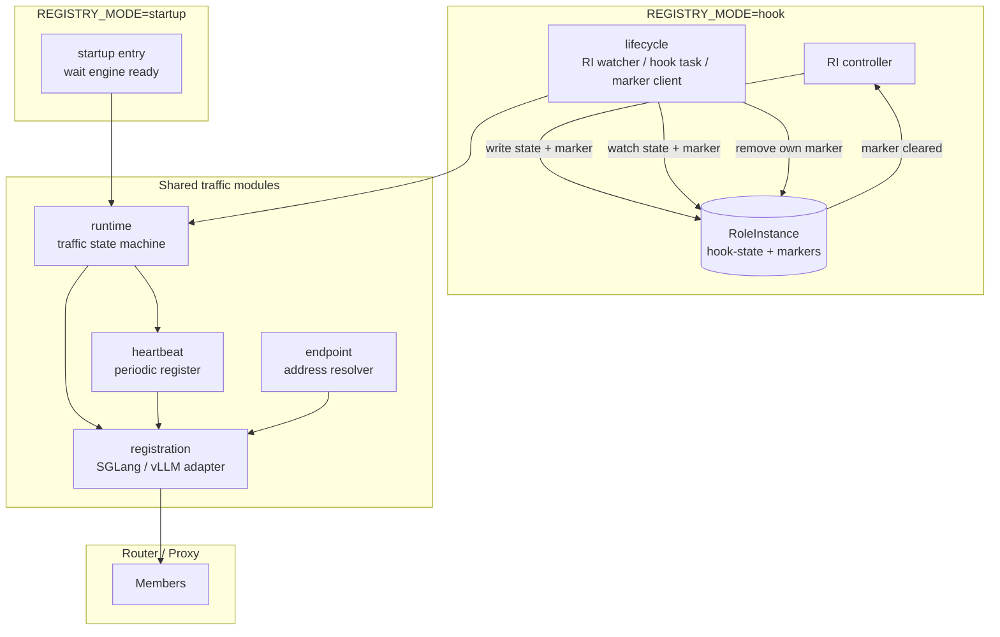

# Proposal 14：Patio 作为 RoleInstance 生命周期 Hook Executor

| 项目 | 内容 |
| --- | --- |
| 状态 | draft |
| 日期 | 2026-11-04 创建，2026-11-06 更新 |
| 作者 | inference-engine-runtime 维护者 |
| 参考 | `rbg/keps/527-roleinstance-lifecycle/README.zh-CN.md` |
| 范围 | `postReady` 上线，`preUpdate` / `preDelete` 摘流与排空 |

## 摘要

本文中的核心术语先说明如下：RoleInstance（RI）是 RBG 的实例级资源；`postReady` / `preUpdate` / `preDelete` 是 RBG 定义在 RI 上的实例级 lifecycle hook；marker 是 controller 写入 RI labels 的 hook 触发标记；`REGISTRY_MODE` 是选择 Patio 注册控制入口的环境变量。

Patio 当前在进程启动后立即向 SGLang router / vLLM proxy 注册 worker，并由周期性 re-register 维持成员关系。该行为与 RBG 的实例级生命周期协作冲突：实例可能在 `postReady` 前接流量，也可能在 `preUpdate` / `preDelete` 摘流后因重启或 SIGTERM 被重新注册。

本 proposal 将注册控制改为可配置的 `REGISTRY_MODE`：

```text
REGISTRY_MODE=startup | hook | none
```

默认保持 `startup` 以兼容现有部署。指定为 `hook` 时，Patio 成为 RBG RoleInstance lifecycle hook 的 registration executor：由 RoleInstance 的 `hook-state` 与 marker 驱动上线、下线和排空，成功后只清除自己的 marker。

## 动机

### 现状

当前 `topo_client` 的行为是：

```text
Patio 启动
  -> 推导 router / worker / engine endpoint
  -> 等待 engine ready
  -> register
  -> 周期性 re-register
  -> SIGTERM / SIGINT 时 unregister
```

这适合“启动即上线”的部署，但不适合由 RBG 控制的实例生命周期：

1. `postReady` 前实例可能已经注册并接收流量；
2. `preUpdate` / `preDelete` 摘流后，进程重启可能重新注册；
3. SIGTERM 是进程事件，不代表 RBG 生命周期状态；
4. endpoint 推导、注册协议、heartbeat 和信号处理耦合在 `topo_client` / `app.py` 中。

### 目标

1. 保留现有 startup 注册行为，默认不破坏存量部署；
2. 支持 RBG marker 驱动的上线与下线；
3. 下线时先停止 heartbeat，等待最后一次 register 完成，再 unregister；
4. 建立通用排空语义，框架差异由 adapter 解释；
5. 明确 RBG、编排系统和 Patio 的权责边界。

### 非目标

1. 不修改 RBG API、RoleInstance spec 或 controller 状态机；
2. 不实现 executor 选举、Lease 或授权；
3. 不管理 Pod finalizer 和 Pod 删除时序；
4. 不处理 `preRecover`；
5. 不定义多 Pod RoleInstance 的成员发现与动作聚合协议；
6. 不实现业务自定义排空检查；业务需要额外排空约束时另行 proposal。

### 用户影响

| 用户 | 影响 | 是否需要行动 |
| --- | --- | --- |
| Kubernetes / RBG 运维人员 | 可以通过 `REGISTRY_MODE=hook` 让 Patio 参与实例级上线、摘流和排空；前置 hook 失败时会持续阻塞对应操作 | 启用前需部署新版本 Patio、注入 RI 名称和 marker 配置，并授予最小 Kubernetes API 权限 |
| 应用开发者 | `postReady` 前 Patio 不注册 worker，`preUpdate` / `preDelete` 后不再由重启或 SIGTERM 自动注册；流量恢复依赖 RBG hook 和 router 状态 | 需要确认业务是否有长连接、流式请求或额外排空检查 |
| SGLang / vLLM 集成开发者 | 注册协议被拆分为 adapter，并需要提供可确认的 unregister 和排空状态 | 需确认 router / proxy API 与指标语义 |
| Patio 维护者 | `topo` 职责拆分为 endpoint、registration、runtime、heartbeat 和 lifecycle，新增 Kubernetes watch / patch 逻辑 | 需按新模块边界实现并补充测试 |

## 提案

### 用户故事

```text
作为一名 Kubernetes 运维人员，
我希望 Patio 只在 RBG postReady 之后注册推理 worker，
以便实例在受控操作就绪前不会接收流量。
```

```text
作为一名 Kubernetes 运维人员，
我希望 Patio 在更新或删除前停止 heartbeat 注册、注销并排空请求，
以便 RBG 可以安全替换或删除 RoleInstance。
```

```text
作为一名 SGLang / vLLM 集成开发者，
我希望注册和排空行为由显式 adapter 表达，
以便框架差异不会泄漏到 lifecycle 状态机中。
```

## 术语

| 术语 | 含义 |
| --- | --- |
| Patio | 本项目 inference-engine-runtime 的运行时进程，作为推理引擎 sidecar。 |
| RoleInstance，RI | RBG 中的实例级资源，一个 RI 代表一个推理实例；本 proposal 首版只支持单 Pod / 单 executor。 |
| `hook-state` | RBG controller 写在 RI label `rbg.workloads.x-k8s.io/role-instance-hook-state` 上的阶段标记，例如 `PreUpdate`、`PreDelete`、`PostReady`。 |
| marker | RI label 中的 `key=value`，用于告诉 executor 需要处理某个 hook；executor 完成后删除自己的 marker。 |
| hook executor | 观察 marker、执行业务动作并清除 marker 的组件。本 proposal 中由 Patio 承担 registration hook executor。 |
| registration | worker 加入 / 退出 router 或 proxy 成员列表的协议。 |
| endpoint | router / proxy、worker、engine health 的访问地址。 |
| heartbeat | 周期性调用 register 的自愈机制，用于 router 重启后恢复注册。 |
| drain / 排空 | 从 router / proxy 成员中移除后，等待已分配请求完成的过程。 |
| fail closed | 无法确认结果时保持阻塞状态，不清 marker，让 controller 继续等待。 |
| `REGISTRY_MODE` | Patio 的环境变量，选择注册控制入口：启动即注册、hook 驱动注册、完全不注册。 |

## 1. 架构调整

### 1.1 当前架构

当前 `topo_client` 同时承担：

- endpoint 推导；
- engine health 等待；
- register / unregister；
- heartbeat re-register；
- SIGTERM 注销。

它不是 RI 级流量控制器，也不是 lifecycle executor。

### 1.2 目标架构



startup 和 hook 是互斥入口：startup 直接驱动 traffic runtime；hook 由 lifecycle marker 驱动 traffic runtime。两者共享 runtime、heartbeat、registration 和 endpoint。`REGISTRY_MODE=none` 没有入口，不做注册相关动作。

### 1.3 目录组织变化

`api/`、`engine/`、`metrics/` 与本 proposal 无关，保持不变。

当前结构：

```text
patio/
├── app.py
├── envs.py
├── api/
├── engine/
├── metrics/
└── topo/
    ├── client/
    │   ├── base_topo_client.py
    │   ├── sgl_topo_client.py
    │   └── vllm_topo_client.py
    ├── factory.py
    ├── server/
    └── utils.py
```

目标结构：

```text
patio/
├── app.py
├── envs.py
├── api/
├── engine/
├── metrics/
├── lifecycle/
├── runtime/
│   └── heartbeat/
├── registration/
└── endpoint/
```

迁移关系：

| 当前 | 目标 | 变化 |
| --- | --- | --- |
| `topo/client/*` | `registration/` | 只保留 SGLang / vLLM 成员注册协议 |
| `topo/utils.py` 中的地址推导 | `endpoint/` | 独立推导 router / worker / engine endpoint |
| `app.py` 中的 heartbeat loop | `runtime/heartbeat/` | 封装可 start / stop 的周期 register |
| `app.py` 中的启动和信号编排 | `runtime/` | 按 `REGISTRY_MODE` 驱动 startup / hook / none |
| 新增 | `lifecycle/` | watch RI、匹配 marker、调度动作、删除 marker |
| `topo/server/` | 保持现状 | 与 hook executor 主线无关 |

### 1.4 模块边界

| 模块 | 职责 | 不负责 |
| --- | --- | --- |
| `lifecycle` | 观察 RI、匹配 hook、调度动作、删除 marker | router 协议、finalizer、授权 |
| `runtime` | 上线/下线状态机、最新 hook-state 抢占、任务重试 | Kubernetes API |
| `registration` | SGLang / vLLM register / unregister 协议 | 决定何时调用 |
| `endpoint` | 推导 router / worker / engine 地址 | 注册协议 |
| `heartbeat` | 周期性 register 的启停封装 | 生命周期决策 |

### 1.5 Registration 语义

Registration 只封装成员注册协议：

```text
register
unregister
status
```

SGLang 成员身份：

```text
稳定逻辑身份 = worker endpoint
worker_id = router 内部句柄
```

Patio 不把 `worker_id` 作为持久状态。SGLang router 支持 list worker；`unregister` 的语义是：list 当前成员，按稳定 worker endpoint 查找并移除对应成员，直到 list 结果确认成员已不再存在。成员不存在时视为幂等成功；无法确认成员状态时 fail closed，不清 marker。如果一个 endpoint 对应多个逻辑成员，必须覆盖全部匹配成员。

vLLM 成员身份：

```text
register   -> POST /instances/add
unregister -> POST /instances/remove
```

vLLM proxy 已提供 `/instances/remove` 接口。当前 Patio 实现中 `unregister` 是 no-op，属于落后实现，需要补齐。remove 调用失败或无法确认结果时 fail closed，不清 marker。

### 1.6 Endpoint 与 Heartbeat

Endpoint 推导独立于注册协议，负责根据环境变量和实例信息推导：

```text
router / proxy endpoint
worker endpoint
engine health endpoint
```

Heartbeat 是周期性调用 register 的自愈机制，不是下线控制器：

1. `start()` 后周期性 register；
2. `stop()` 后不再调度新的 register；
3. start / stop 幂等；
4. `preUpdate` / `preDelete` 先 stop heartbeat；
5. 等待最后一次 register 请求完成后再 unregister；
6. `postReady` 完成注册后 start heartbeat。

heartbeat 存在时，单次 register 失败可以由下一次 heartbeat 重试；registration 原语不需要额外叠加长时间 retry。

## 2. RBG 与 Patio Hook Executor 的配合方式

### 2.1 Kubernetes API 协议

Patio 固定访问以下资源，不把 GVR 和 state key 做成配置项：

```text
group:   workloads.x-k8s.io
version: v1alpha2
kind:    RoleInstance
plural:  roleinstances
scope:   Namespaced
```

lifecycle hook state label 固定为 KEP-527 的规范值：

```text
rbg.workloads.x-k8s.io/role-instance-hook-state
```

Patio 只处理本 proposal 范围内的三个 state：

```text
PreUpdate
PreDelete
PostReady
```

`Updating`、`Recovering`、`Terminating`、`Running` 以及未知 state 不触发 Patio 注册动作。旧 RoleInstanceSet 状态机使用的 `rbg.workloads.x-k8s.io/role-instance-lifecycle-state` 不是本协议的一部分。

### 2.2 协作流程

`REGISTRY_MODE=hook` 时：

1. RBG controller 在进入 hook 阶段时写入 `hook-state` 和 marker；
2. Patio watch 指定的 RoleInstance；
3. 只有 `hook-state` 与 marker 同时匹配时才执行动作；
4. Patio 在执行有副作用的动作前 GET 最新 RI，并再次确认 state 与 marker 仍匹配；
5. Patio 执行 register / unregister / drain；
6. 成功后，Patio 只删除自己的 marker；
7. RBG controller 根据 marker 是否仍匹配决定是否继续。

协议边界：

- controller 不调用 Patio HTTP API；
- Patio 不向 controller 上报业务结果；
- 前置 hook 失败时 marker 保留，controller 继续等待；
- `postReady` 异步执行，不阻塞 RI phase 进入 `Running` 或 RI Ready；
- RBG 可以为一个 hook 配置多个 marker，Patio 只处理其中一个；
- 一个 marker 只由一个 executor 使用；重复指定属于部署配置错误。

“执行前 GET 并复核”不是分布式锁，只能减少陈旧 watch 事件的影响。GET 与动作之间仍存在状态变化窗口；该窗口依赖 controller 状态转换契约、marker 所有权、动作幂等性和最新 hook-state 抢占语义。

### 2.3 Marker 删除

删除 marker 使用幂等的 JSON Merge Patch：

```json
{
  "metadata": {
    "labels": {
      "patio.engine/update-block": null
    }
  }
}
```

删除前基于最新 watch 对象、本地缓存或 GET 确认：

```text
hook-state 匹配
marker key/value 匹配
```

不匹配时不 PATCH。marker 已不存在时视为已清理或已过期。单独的“读取最新对象 + PATCH”不是强并发锁；本设计接受该窗口，协议假设一个 marker 只由一个 executor 使用。

### 2.4 `preDelete` 权责边界

`preDelete` 删除时序由 RBG controller 和编排系统保证：

1. RBG controller 负责 Pod finalizer 的注入、等待和清除；
2. RBG controller 保证 marker 清除前不主动删除业务 Pod；
3. hook executor / sidecar 可用性和故障恢复由部署系统负责；
4. Patio 只执行摘流、排空和 unregister；
5. Patio 不注入、不删除、不校验 Pod finalizer，也不保证 sidecar 存活。

如果 executor 不可用，marker 保留，controller 继续等待。外部直接删除 Pod 不触发 preDelete，按 RBG Recovery 语义处理。

## 3. 环境变量和控制内容

### 3.1 `REGISTRY_MODE`

`REGISTRY_MODE` 选择 Patio 的注册控制入口：

```text
REGISTRY_MODE=startup | hook | none
```

默认值：

```text
REGISTRY_MODE=startup
```

| 模式 | 语义 |
| --- | --- |
| `startup` | 保持现有行为：启动时等待 engine ready，register，并启动 heartbeat；不处理 lifecycle marker |
| `hook` | 本实例是被指定的 registration hook executor：启动不注册、不启动 heartbeat，由 marker 驱动 register / unregister / drain，并清除自己的 marker |
| `none` | 不注册、不启动 heartbeat、不处理 lifecycle marker |

`hook` 和 `startup` 互斥，避免摘流期间进程重启后又被启动逻辑重新注册。

hook executor 由 RBG / 编排系统通过注入 `REGISTRY_MODE=hook` 指定。Patio 不做选举、不做 Lease、不判断授权。其他 Pod 的 Patio 使用 `REGISTRY_MODE=none`。

### 3.2 环境变量

| 变量 | 必填条件 | 含义 |
| --- | --- | --- |
| `REGISTRY_MODE` | 可选，默认 `startup` | 注册控制模式 |
| `LIFECYCLE_RI_NAME` | `REGISTRY_MODE=hook` 必填 | 要 watch 的 RoleInstance 名称 |
| `LIFECYCLE_PRE_UPDATE_MARKER` | `hook` 时至少配置一个 marker | `preUpdate` 触发 marker |
| `LIFECYCLE_POST_READY_MARKER` | `hook` 时至少配置一个 marker | `postReady` 触发 marker |
| `LIFECYCLE_PRE_DELETE_MARKER` | `hook` 时至少配置一个 marker | `preDelete` 触发 marker |
| `LIFECYCLE_DRAIN_CHECK_INTERVAL` | 可选，默认 `1s` | 排空快照轮询间隔 |
| `LIFECYCLE_DRAIN_STABLE_SAMPLES` | 可选，默认 `3` | 判定 idle 前连续成功的 idle 快照数量 |

marker 示例：

```text
LIFECYCLE_PRE_UPDATE_MARKER=patio.engine/update-block=true
LIFECYCLE_POST_READY_MARKER=patio.engine/ready-block=true
LIFECYCLE_PRE_DELETE_MARKER=patio.engine/delete-block=true
```

规则：

1. marker 使用 `key=value` 字符串；
2. Kubernetes label key/value 不包含 `=`，以第一个 `=` 拆分；
3. 缺失 `=`、key 为空或不符合 label 语法时拒绝启动；
4. 未设置表示该 hook 对本 executor 禁用，不表示 Patio 需要校验 RBG 是否配置了该 hook；
5. `REGISTRY_MODE=hook` 时至少配置一个 marker；所有 marker 都未设置属于 Patio 自身配置错误，应拒绝启动；
6. Patio 只观察、处理并删除自己配置的 marker。

`REGISTRY_MODE=hook` 时必须注入 `LIFECYCLE_RI_NAME`。Patio 使用 Pod service account 推导当前 namespace，只访问该 namespace 中该名称对应的 RoleInstance，不提供跨 namespace 配置。Patio 不注入、不读取 RI UID，不通过 owner reference、labels 或其他方式发现成员；是否运行 executor、运行在哪个成员上，由部署方通过 `REGISTRY_MODE` 控制。

本 proposal 暂不处理同名 RI 删除重建的 UID fencing。RBG 的 preDelete finalizer 保证旧 RI 在完成删除前不会被新对象替代；Patio 的 register / unregister / marker 清理动作也必须幂等，可被多次执行或重放。

RBG Role 中的 `lifecycle.labelsHandler` 是 marker 配置源头。长期建议 RBG / 编排系统根据生效 lifecycle 配置向 executor 注入 marker ENV，避免双份配置；当前也允许部署方手工注入。配置与 RBG 生效配置不一致时，属于部署配置错误。

### 3.3 信号行为

SIGTERM / SIGINT 语义：

| 模式 | 行为 |
| --- | --- |
| `startup` | 停止 heartbeat，best-effort unregister，然后退出 |
| `hook` | 停止 heartbeat 和本地任务，直接退出；不 unregister、不清 marker |
| `none` | 直接退出，不做注册相关动作 |

hook 模式下，信号不能代表 RBG 生命周期状态，必须禁止非 hook 控制的 unregister。信号中断未完成的 pre hook 时保留 marker，流程恢复交由 RBG 编排。

## 4. 执行逻辑和示意代码

以下代码是伪代码，只表达执行顺序和模块协作，不代表最终接口或实现。

### 4.1 启动入口

```python
def run(config):
    endpoints = endpoint_resolver.resolve()
    registration_adapter = registration.create(config.protocol, endpoints)
    heartbeat = Heartbeat(registration_adapter.register)
    runtime = TrafficRuntime(registration_adapter, heartbeat)

    if config.registry_mode == "startup":
        runtime.startup()
    elif config.registry_mode == "hook":
        lifecycle.run(
            role_instance_name=config.lifecycle_ri_name,
            markers=config.lifecycle_markers,
            runtime=runtime,
        )
    elif config.registry_mode == "none":
        return
```

startup 模式：

```python
async def startup(self):
    await self.engine.wait_ready()
    await self.registration.register()
    self.heartbeat.start()
```

hook 模式启动时不注册、不启动 heartbeat，只等待 RI 事件。

### 4.2 RI 事件分发

```python
async def run(role_instance_name, markers, runtime):
    async for event in watch_role_instance(role_instance_name):
        runtime.cancel_hook_if_state_changed(event.state)

        if event.state == "PostReady" and event.matches(markers.post_ready):
            await handle_post_ready(event, runtime, markers.post_ready)

        elif event.state in ("PreUpdate", "PreDelete"):
            if event.state == "PreUpdate" and event.matches(markers.pre_update):
                await handle_pre_hook(event, runtime, markers.pre_update)
            elif event.state == "PreDelete" and event.matches(markers.pre_delete):
                await handle_pre_hook(event, runtime, markers.pre_delete)
```

必须同时匹配 `hook-state` 与 marker。仅存在旧 marker 不能触发动作。

Patio 使用“最新 hook-state 优先”的抢占语义。观察到新的 hook-state 后，本地旧 hook 任务停止继续推进：不再清理旧 marker，正在执行的 register / unregister 请求由底层原语按取消或等待完成处理，后续步骤不再执行；然后按最新 state 和 marker 调度新动作。Patio 不用本地优先级规则覆盖 controller 的 state。哪些 state 可以相互转换、何时写入新 state，由 RBG controller 负责保证；异常转换属于 controller / 配置问题，不是 Patio 的决策职责。

### 4.3 `postReady` 上线

触发条件：

```text
hook-state=PostReady
postReady marker 匹配
```

```python
async def handle_post_ready(event, runtime, marker):
    await runtime.register()
    runtime.heartbeat.start()
    runtime.set_serving()
    await marker.clear_if_still_matching(event)
```

规则：

1. 确认 engine ready；RBG 的工作负载 Ready 是 controller 视角，Patio 在执行注册前仍以本地 engine health 为准；
2. 完成注册；
3. 启动 heartbeat；
4. 进入 serving；
5. 清除自己的 marker；
6. 失败时保留 marker 并按有界退避重试。

`postReady` 不阻塞 controller 将 phase 置为 `Running`。业务流量是否恢复由 router / proxy 状态决定。

### 4.4 `preUpdate` / `preDelete` 摘流与排空

触发条件：

```text
hook-state=PreUpdate / PreDelete
对应 marker 匹配
```

```python
async def handle_pre_hook(event, runtime, marker):
    runtime.begin_drain()

    await runtime.heartbeat.stop(wait_inflight=True)
    await runtime.unregister()
    await runtime.wait_until_drained()

    await marker.clear_if_still_matching(event)
```

执行顺序：

```text
preUpdate / preDelete marker
  -> heartbeat.stop()
  -> 等待最后一次 register 完成
  -> unregister
  -> 等待排空
  -> 清除自己的 marker
```

任一步骤失败或返回 `unknown` 时保留 marker，记录失败阶段，并按有界退避从幂等动作重新执行；不能跳过失败步骤。退避期间不启动 heartbeat，也不能把 pre hook 清理为成功。

所有 hook 动作必须是幂等、可重放、可取消的。旧任务中断后：

1. 不清理已经不匹配当前 state 的旧 marker；
2. 已经产生的 register / unregister 副作用由新 state 对应动作或后续重放收敛；
3. 只有当前 `hook-state` 与 marker 仍匹配时才允许清理 marker；
4. controller 负责保证 state 转换顺序合理，避免正常的 postReady 被异常 pre hook 抢占。

摘流成功的高层条件：

1. router / proxy 成员已移除，或确认本来不存在；
2. unregister 后不再调度新的 register / heartbeat；
3. 推理框架 adapter 报告排空状态为 `idle`；
4. `idle` 状态在配置窗口内连续稳定；
5. 首版不执行业务自定义排空检查；业务有额外约束时另行扩展；
6. marker 删除前 state 与 marker 仍匹配。

### 4.5 排空快照

runtime 只定义通用排空语义；各推理框架由 adapter 解释“什么是 active / queued / drained”。

```text
state: idle | draining | unknown | unsupported
active_requests: number | unknown
queued_requests: number | unknown
swapped_requests: number | unknown | not-applicable
source: sglang-metrics | vllm-metrics | engine-api
```

规则：

1. `unknown` 和 `unsupported` 不能视为 idle；
2. `/metrics` 可访问但必需指标不存在时返回 `unsupported`；网络失败、超时、5xx、解析失败或 NaN 时返回 `unknown`；
3. 框架无法提供排空状态时，前置 hook fail closed；
4. 判定 idle 需要 active / queued / swapped 连续为 0，且达到 `LIFECYCLE_DRAIN_STABLE_SAMPLES`；
5. 抓取失败、解析失败或返回 `unknown` 会重置稳定样本计数；
6. 本 proposal 不提供自动超时或自动放行策略；持续失败时 marker 保留，由运维显式处理。
7. 首版不支持业务自定义排空检查；如指标语义不足以表达业务约束，需要另行 proposal 定义扩展接口。

SGLang 首版映射：

```text
sglang:num_running_reqs -> active_requests
sglang:num_queue_reqs   -> queued_requests
```

两者连续为 0 时报告 `idle`。

默认 vLLM 排空快照必须包含三个当前状态 gauge：

```text
vllm:num_requests_running -> active_requests
vllm:num_requests_waiting -> queued_requests
vllm:num_requests_swapped -> swapped_requests
```

判定 idle 的高层条件：

```text
active_requests == 0
and queued_requests == 0
and swapped_requests == 0
```

`vllm:num_requests_swapped` 表示被换出到 CPU 但尚未完成的请求；只看 running / waiting 可能在 swapped 请求存在时误判为 idle。`vllm:num_preemptions_total` 是累计 counter，不是当前状态，不能参与排空判定。

指标缺失时按以下规则分类：

1. `/metrics` 可访问但必需指标不存在，返回 `unsupported`；
2. 网络失败、超时、5xx、解析失败或 NaN，返回 `unknown`；
3. `unsupported` 和 `unknown` 都不能视为 idle，marker 保留。

vLLM 指标可以覆盖仍在生成的流式请求，但不能覆盖已经生成完成但仍然保持的 HTTP / SSE / WebSocket 长连接、router / proxy 内部缓冲或外部业务事务。如果业务要求所有外部连接关闭后才能删除，必须使用业务自定义排空检查。

## 5. 权责边界与限制

### RBG / 编排系统负责

- 指定哪个 Pod / sidecar 是 hook executor；
- 注入 `REGISTRY_MODE`、RI 名称和 marker ENV；
- 管理 RoleInstance lifecycle state 和 marker 写入；
- 管理 Pod finalizer 和删除时序；
- 保证 executor 在业务 Pod 删除前可用；
- 处理 controller / executor 故障恢复。

### Patio 负责

- watch 指定 RoleInstance；
- 匹配 state 与 marker；
- 调用 register / unregister；
- 控制 heartbeat 启停；
- 执行排空判断；
- 清除自己的 marker。

### 当前限制

1. 多 Pod RI 的成员发现与动作调用协议需要 RBG 定义。本 proposal 只定义单 Pod / 单 executor 语义，不做成员发现。
2. 首版不做业务自定义排空检查。默认 engine 指标不能覆盖空闲 HTTP / SSE / WebSocket 长连接、router / proxy 内部缓冲或外部业务事务；这些约束需要后续独立 proposal 定义扩展接口。
3. 首版不做 RI UID fencing；依赖 RBG preDelete finalizer 和 Patio 动作幂等性处理同名删除重建。

## 兼容性

1. `REGISTRY_MODE` 默认值保持 `startup`，未显式启用 hook 模式的存量部署不改变注册、heartbeat 和信号行为。
2. `topo` 模块重构是内部结构变化；`TOPO_TYPE`、`--instance-info`、router endpoint 推导和现有注册协议在 `startup` 模式下保持兼容。
3. hook 模式要求 RBG controller 已实现 KEP-527 的新 Role-level lifecycle 协议、`role-instance-hook-state` label 和 marker 写入。Patio 不兼容只存在旧 RIS `PreparingUpdate` / `PreparingDelete` 状态机的部署。
4. SGLang router 需要提供 list worker，并以稳定 worker endpoint 识别和删除成员；vLLM proxy 需要提供 `/instances/remove`。部署版本缺少这些能力时，pre hook fail closed，不能通过忽略 unregister 放行。
5. 版本偏差要求：先升级 Patio / router / proxy 能力，再部署 RBG hook 配置和 `REGISTRY_MODE=hook`。RBG 与 Patio 对 state key、state value 和 marker 匹配语义的理解必须一致。
6. 降级或回滚时，不能直接把仍有匹配 marker 的实例切回 `startup`。操作顺序是先停止新的 RBG 操作，等待或显式处理未完成 hook，确认没有残留 `hook-state` / marker，再移除 hook 配置或回滚 Patio。
7. 新增指标和日志均为附加行为，不承诺现有指标名不变；移除或重命名旧指标时另行提供迁移说明。
8. vLLM 部署版本必须暴露 running / waiting / swapped 三个当前状态 gauge；指标缺失时返回 `unsupported`，前置 hook fail closed。
9. 首版不支持业务自定义排空检查，不提供通用脚本执行或任意 HTTP 检查入口。

## 可观测性

日志必须记录配置解析结果、watch 建立 / 断开 / 重连、hook 触发、register / unregister 结果、drain 快照、marker 清理结果和失败原因。日志不得输出 service account token 或其他敏感配置。

建议新增指标：

| 指标 | 类型 | 标签 | 含义 |
| --- | --- | --- | --- |
| `patio_lifecycle_event_total` | Counter | `state`, `matched` | 收到的 RI 事件数，以及 state / marker 是否匹配 |
| `patio_lifecycle_action_total` | Counter | `hook`, `result` | hook 动作成功、失败、取消次数 |
| `patio_lifecycle_action_duration_seconds` | Histogram | `hook`, `phase` | register、unregister、drain、clear marker 的耗时 |
| `patio_registration_state` | Gauge | `engine`, `protocol` | 当前本地 traffic state：未注册、注册中、serving、draining、未注册确认 |
| `patio_drain_state` | Gauge | `engine`, `source` | adapter 报告的 idle / draining / unknown / unsupported |
| `patio_lifecycle_watch_errors_total` | Counter | `operation`, `reason` | watch / patch / get 失败次数 |

指标标签不包含 RoleInstance 名称，避免在大规模部署中产生高基数；单进程诊断可以通过日志中的实例名关联。

Patio 的 HTTP health / readiness 不因 hook 处理中而自动失败。Patio Ready 只表示进程和 API 可用，不表示业务注册完成或排空完成；对外流量准入由 RBG、router / proxy 和部署方控制。

排查指引：

1. 前置 marker 长期保留：检查 Patio 是否运行在 `REGISTRY_MODE=hook`、watch 是否正常、action 失败日志、router / proxy 是否可达、drain 是否为 `unknown` / `unsupported`。
2. `postReady` marker 长期保留：检查 engine ready、register 失败和 heartbeat 状态；它不代表 controller 阻塞。
3. 实例未接流量：检查 Patio 是否未收到 postReady marker、marker 配置是否与 RBG 生效配置一致、router 成员状态和 heartbeat。
4. controller 未推进：检查是否还有其他 executor 的 marker 未清除，Patio 只清除自己配置的 marker。

## 安全性

1. hook 模式必须使用专用 ServiceAccount。Patio 从 Pod service account 推导当前 namespace，且只访问该 namespace。最小 RBAC 为当前 namespace 中 `roleinstances` 的 `get`、`patch`；如果使用 LIST/WATCH，还需 `list`、`watch`，并尽量用 `metadata.name` field selector 限制范围。
2. Kubernetes 原生 RBAC 不能限制 PATCH 只修改某个 label key。需要接受该限制并使用专用 ServiceAccount、最小权限和审计日志；如需严格字段隔离，需要 admission 或代理层。
3. Patio 使用进程内 service account token 和 namespace 推导，不引入长期明文 token 配置。RI 名称和 marker 是非敏感配置，但 marker key / value 必须按 Kubernetes label 语法校验，防止拼接出非法 patch。
4. marker 清理只使用 JSON Merge Patch 删除自己配置的 key，不整体替换 `metadata.labels`。
5. router / proxy 和 engine endpoint 属于集群内信任边界。现有 HTTP endpoint 不新增认证协议；跨信任域部署时应由网络策略、mTLS 或代理层保护，而不是由本 proposal 扩大信任模型。
6. watch、PATCH 和 adapter 调用必须有超时和有界退避，避免 API 故障或慢响应耗尽线程 / 协程和文件描述符。

## 性能与可扩展性

1. 每个 hook executor 只 watch 一个指定 RoleInstance，并使用 field selector 或客户端过滤，避免全 namespace informer。
2. 本地缓存只需要当前 RI 对象和内部 traffic state；resourceVersion 越界或 watch 重连时重新 LIST/GET，不维护历史对象。
3. heartbeat 周期沿用 `HEARTBEAT_INTERVAL`，不因 lifecycle 模式增加额外周期写。
4. drain 轮询使用独立间隔、最小样本数和稳定窗口；请求失败计入 backoff，不把失败样本当作 idle。
5. 每个进程额外消耗一个 Kubernetes watch 连接和少量内存。指标基数固定为 state / hook / result / engine / source 的有限组合。
6. 排空耗时主要取决于业务请求和 engine 指标刷新，不属于 Patio 可承诺的性能 SLO；benchmarks 只用于确认 hook 和 watch 自身开销可忽略。

## 风险与缓解

| 风险 | 影响 | 检测 | 缓解 |
| --- | --- | --- | --- |
| Patio 与 RBG hook-state ABI 不一致 | hook 永不触发，实例无法上线或无法摘流 | lifecycle event 指标、watch 日志 | 固定使用 `role-instance-hook-state` 和 KEP-527 规范值，并在集成测试中绑定 RBG 测试版本 |
| 部署的 router / proxy 版本缺少所需 remove / list 能力 | pre hook 持续 fail closed，更新 / 删除阻塞 | action failure 指标和日志 | 能力矩阵写入文档；版本不满足时禁止启用 hook 模式 |
| marker / state 配置与 RBG 生效配置不一致 | marker 不匹配或被错误清理 | matched / action 指标，启动日志 | 编排系统从 `labelsHandler` 注入 ENV；实现启动前做格式校验，集成测试覆盖不一致场景 |
| watch 事件陈旧或同名 RI 重建 | 基于旧对象执行 unregister / register | resourceVersion 日志、注册状态 | 执行副作用前 GET 最新对象并复核 state / marker；依赖 preDelete finalizer 和动作幂等，首版不做 UID fencing |
| executor 在 pre hook 中重启 | 动作重复或中断 | action result、进程重启日志 | register / unregister 必须幂等；marker 保留并在重启后重放 |
| engine 指标缺失或解析失败 | 无法确认 idle，前置 hook 长期等待 | drain state 指标 | `unknown` / `unsupported` fail closed；提供日志和指标定位 |
| 长连接 / 流式请求未计入 active requests | 过早清除 marker，请求被中断 | 业务错误率、drain 耗时分布 | 指标只作为首版默认；业务可扩展自定义检查，长流式场景需显式确认 |
| 误将 executor 配置为 `startup` | 摘流后重启自动注册 | registry state / heartbeat 日志 | hook 模式必须显式注入；部署文档和配置校验避免静默回退 |

## 缺点

1. Patio 从纯启动注册 sidecar 变成依赖 Kubernetes API 和 RBG 生命周期的协作组件，部署复杂度显著增加。
2. marker 协议没有结构化业务结果，controller 只能看到等待或放行，具体失败需要查询 Patio 日志和指标。
3. 前置 hook fail closed 可能让更新 / 删除无限期等待；这是安全优先的选择，但需要运维和告警配套。
4. 模块拆分和 adapter 化增加代码面积，短期内比直接修改 `topo_client` 更重。
5. state key、marker、RBAC 和 router API 能力形成跨项目 ABI，版本偏差排查成本更高。

## 替代方案

### 只保留 startup 注册

优点是改动最小，缺点是无法参与 `postReady` / `preUpdate` / `preDelete` 协作，无法安全摘流和排空。

### RBG controller 直接调用 Patio HTTP API

优点是控制直接，缺点是 controller 必须理解业务 API、网络连通和 executor 可用性，职责耦合。RBG KEP 选择 marker 协作，本 proposal 保持该边界。

### 全部实例强制 hook 模式

语义清晰，但破坏存量“启动即上线”部署。因此默认使用 `startup`，hook 由编排系统显式指定。

### 在 Patio 内实现 executor 选举

可以自动决定 executor，但引入 Lease、授权和脑裂问题。本 proposal 认为谁执行 hook 是部署 / 编排决策，不是 runtime 决策。

## 测试计划

### 单元测试

1. `REGISTRY_MODE` 解析：默认 `startup`，非法值拒绝启动；`hook` 缺少 RI 名称或 marker 拒绝启动。
2. marker `key=value` 解析：首个 `=` 拆分、空 key、非法 label key / value、重复配置、值为空均拒绝。
3. RI 事件分发：`PreUpdate`、`PreDelete`、`PostReady` 与 marker 必须同时匹配；仅旧 marker 不触发；未知 state 忽略；事件重复只触发幂等处理。
4. traffic state machine：`postReady` register 成功后启动 heartbeat；pre hook 先 stop heartbeat、等待 inflight register、再 unregister；最新 hook-state 抢占旧任务后不清理旧 marker。
5. heartbeat：start / stop 幂等；stop 后不调度新请求；能等待最后一次 register 完成；心跳异常不改变 drain 状态。
6. marker 清理：JSON Merge Patch 只删除自己的 key；state 或 marker 已变化时不 PATCH；对象不存在、marker 已删除、PATCH 冲突的处理。
7. drain adapter：`/metrics` 可访问但必需指标缺失时返回 `unsupported`；网络失败、超时、5xx、NaN、非数字或解析失败返回 `unknown`；两者都不视为 idle，且会重置稳定样本计数。
8. vLLM drain：running / waiting 为 0 但 swapped 大于 0 时不能报告 idle；三者连续为 0 且达到稳定样本数后报告 idle。
9. SGLang drain：running / queue 任一大于 0 时不能报告 idle；两者连续为 0 且达到稳定样本数后报告 idle。
10. signal：三种模式下的 SIGTERM / SIGINT 行为；hook 模式中断后 marker 保留且不 unregister。

### 集成测试

1. 使用 fake Kubernetes API server 建立单 RI watch，覆盖 LIST/WATCH 重连、resourceVersion 过期、陈旧事件、marker PATCH 失败和对象删除。
2. 使用 mocked SGLang router / vLLM proxy 验证 register 幂等、unregister 幂等、remove 失败、进程重启后丢失句柄、router 重启后的 heartbeat 恢复。
3. 使用 mocked engine metrics 验证 `preUpdate` / `preDelete` 的完整摘流顺序，以及 register / unregister / drain 部分失败时 marker 保留。
4. 验证 `startup` 模式的现有行为不因模块重构改变，作为兼容性回归。

### 端到端测试

仅在 mock 集成无法覆盖 Kubernetes 与真实 engine 行为时执行：

1. 真实 RBG controller + Patio + SGLang router 的 create / postReady / update / delete 流程。
2. 真实 RBG controller + Patio + vLLM proxy 的 `/instances/add` / `/instances/remove` 流程。
3. executor 重启、router 重启、Kubernetes API 短暂不可用和 engine 指标暂时不可用。
4. 版本偏差矩阵：新版 Patio + 未启用 lifecycle 的 RBG、新版 RBG + `startup` Patio、双方均启用 hook。

### 失败与对抗测试

1. 注入非法 ENV、缺失 RBAC、403 PATCH、409 conflict、5xx watch、超时、慢 router 响应和 malformed JSON。
2. 在 heartbeat register 与 unregister 并发时触发 pre hook，验证不会出现 stop 后再注册。
3. 在 postReady、preUpdate、preDelete marker 相继出现时验证最新 hook-state 抢占旧任务。
4. 在 drain 期间修改 state / marker：旧任务停止推进且不清理 marker，新动作按最新 state 执行；同名 RI 重建时动作可幂等重放；多个 marker executor 只清理自己的 key。
5. 验证不会因 `unknown` / `unsupported`、请求失败或指标抓取失败而误判 idle。

### 基准测试

对本 proposal 不承诺业务排空时间 SLO。只建议在大规模实例数下测量单进程 watch / drain 轮询的 CPU、内存、FD 和网络开销，并与 `startup` 模式对比确认 lifecycle watch 自身开销可忽略。

## 上线计划

1. 阶段一：完成模块拆分和 adapter 化，但默认仍为 `startup`，所有现有测试保持通过。
2. 阶段二：发布 `REGISTRY_MODE=hook` 的 alpha 实现，补充 RBAC 示例、部署文档、日志和指标。该阶段要求 SGLang / vLLM 能力矩阵明确。
3. 阶段三：由 RBG / 编排系统从 Role 的 `labelsHandler` 注入 marker ENV，在测试集群小范围启用，观察 postReady / preUpdate / preDelete。
4. 阶段四：确认无未完成 marker 和 state 后扩大范围。
5. 回滚：保持 `REGISTRY_MODE=startup` 可用；未完成 hook 时先停止操作并处理 marker，再回滚。不支持通过手动删除 marker 伪报成功作为常规回滚手段。
6. 废弃：如果后续 RBG marker 协议变化， Patio 使用新 state / marker ABI，不静默兼容同名旧协议。

## 开放问题

以下设计决策已确定，不再作为开放问题：

1. hook-state key 使用 `rbg.workloads.x-k8s.io/role-instance-hook-state`；
2. Patio 只处理 `PreUpdate`、`PreDelete`、`PostReady`；
3. 不注入、不读取 RI UID，首版不做 UID fencing；
4. 使用 Pod service account，并只访问 Pod 所在 namespace；
5. SGLang 使用 list worker 并按 endpoint 幂等删除；vLLM 使用 `/instances/remove`；
6. 最新 hook-state 永远抢占上一个本地 hook 任务；
7. drain 默认 1 秒轮询、连续 3 个成功 idle 样本后判定完成。

当前没有阻塞性设计开放问题。业务自定义排空检查如果后续需要支持，应另立 proposal，定义接口契约、认证边界和失败分类。

## 实现历史

- 2026-11-04：初始 proposal，定义 `REGISTRY_MODE`、marker 协作、模块拆分、pre hook 摘流顺序和通用 drain 快照。
- 2026-11-06：对照 proposal 模板补充 User Impact、Compatibility、Observability、Security、Performance、Risks、Drawbacks、Test Plan 和 Rollout；修正 lifecycle state label 不得复用旧 RoleInstanceSet 状态 key，并整理开放问题。
- 2026-11-06：确认 KEP-527 规范 key 为 `rbg.workloads.x-k8s.io/role-instance-hook-state`；确定不使用 UID fencing、Pod 所在 namespace、SGLang list worker / vLLM remove、最新 hook-state 抢占和 drain 默认参数。
- 2026-11-06：确定 vLLM 排空必须同时检查 running / waiting / swapped 三个 gauge；首版不支持业务自定义排空检查，后续需要另行 proposal。

## 参考

1. RBG KEP-527：`rbg/keps/527-roleinstance-lifecycle/README.zh-CN.md`
2. RBG KEP 模板：`rbg/keps/NNNN-kep-template/README.md`
3. 本仓库 proposal 模板：`proposals/NNNN-template/README.md`
